## The research map {data-menu-title="Research map"}

::: {.hidden}
$$

$$
:::

<!-- Keep this slide first: the block above defines the math macros for the
     whole deck. Same map as the nsi-sep2026 talk, with today's topic (ERGM
     methods) highlighted. The point for this audience is the breadth: where
     a collaboration could start. [1:30 | 1:30] -->

```{mermaid}

```

::: {style="font-size: 80%; color: #666;"}
**Note**: I owe much of the diversity in my work to my collaborators: **it is not a one-person show!**
:::


## Today {data-menu-title="Roadmap"}

<!-- TIMING CONTRACT (content before the first heading becomes an empty
     slide, so this lives here). (45-minute slot, designed to ~43:00)
       Opening (map + roadmap)      3:00   ->  3:00
       Part 1  What is an ERGM     14:00   -> 17:00
       Part 2  Conditioning         6:00   -> 23:00
       Part 3  Information          9:00   -> 32:00
       Part 4  Simulation study     9:00   -> 41:00
       Closing                      2:00   -> 43:00
     The per-slide [budget | clock] comments after the research map are from
     the 40-minute version: add ~3:00 to each clock. If running long, cut
     "Reading the coefficients" (its point is on the ERGMs slide) and "Why
     fits fail".
     Notation: the paper's (notation.tex is a KaTeX port of
     notation-paper.tex).
     Sources: ../../research/ergm-cond-consistency/experiment-loglik/report.md
     (Part 3) and report/report.md (Part 4). Figures: scripts/figures.R. -->

<!-- [1:00 | 1:00] -->

::: {style="font-size: 125%;"}
> Many network models are hard to fit. If we stop modeling **how many** ties there are, do we lose anything about **how** they are arranged?
:::

::: {.incremental}
1. **What is an ERGM?** A statistical model for why ties form, and why fitting it is hard.
2. **Conditioning on the edge count.** What it is, and what it could cost.
3. **How much information do we lose?** The likelihood, split in two.
4. **Does it work in practice?** A simulation study with about 10,000 samples of networks.
:::

::: {.fragment style="font-size: 80%; color: #666;"}
Everything from part 3 on is **preliminary**.
:::


# Part 1 -- What is an ERGM? {background-color="#00707a"}

## Why model a network? {.compact data-menu-title="Why model networks"}

<!-- [1:30 | 3:30] From the Significance section of the proposal. -->

Seeing a pattern in a network is easy. Saying **what produced it** is not.

::: {.columns}
::: {.column width="33%" .fragment}
###  Public health

Do people befriend those who share their behavior, or is it that friends of friends tend to meet?

Contact networks, vaccination behavior, health-care teams.
:::

::: {.column width="33%" .fragment}
###  Neuroscience

Are two brain regions connected beyond what their location predicts?

Whole-brain connectivity from fMRI [@simpson_exponential_2011].
:::

::: {.column width="33%" .fragment}
###  Biology

Do genes that regulate each other also share regulators?

Protein--protein and gene-regulatory networks.
:::
:::

::: {.takeaway .fragment}
In a network, ties depend on each other. Regression assumes they do not. Exponential-family Random Graph Models (ERGMs) are built for the dependence.
:::


## The model in one equation {data-menu-title="ERGM equation"}

<!-- [1:30 | 5:30] Walk the colors: data, parameters, statistics, constant,
     support. Figure: scripts/parts-of-ergm.R. -->

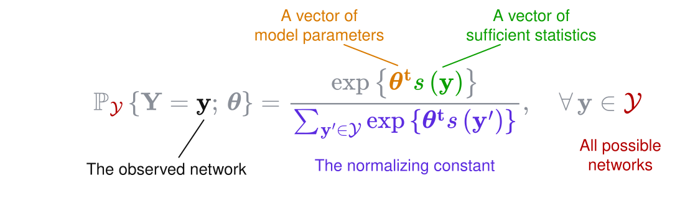{width="85%" fig-align="center"}

::: {.incremental}
- A network is **one draw** from a distribution over all possible networks, $\GRAPH$.
- Networks with more of the features we count are more (or less) likely, depending on the sign of $\params$.
- It is the same family as logistic regression, with the whole network as the outcome [@Hunter2008].
:::


## What goes in $\s{\graph}$: counting structures {.compact data-menu-title="Sufficient statistics"}

<!-- [1:30 | 7:00] These five (plus edges) are the terms of today's
     experiments. Figures from the tabulergm R package. -->

Each statistic counts a **local structure**. Its coefficient says whether the network has more or fewer of them than chance, given everything else in the model.

::: {.columns .terms-row}
::: {.column width="20%" .fragment}
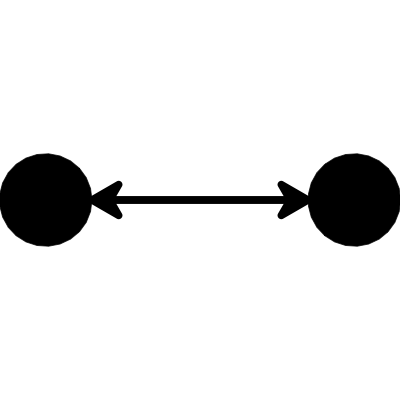{height="130px"}

### Mutual ties

`mutual`

"I name you, you name me"
:::

::: {.column width="20%" .fragment}
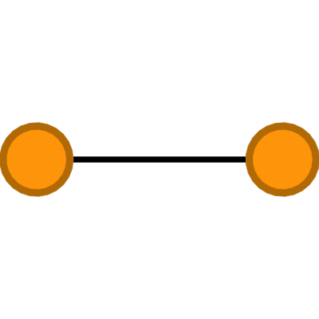{height="130px"}

### Homophily

`nodematch`

"We are alike"
:::

::: {.column width="20%" .fragment}
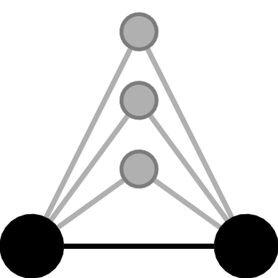{height="130px"}

### Closure

`gwesp`

"Our friends are friends"
:::

::: {.column width="20%" .fragment}
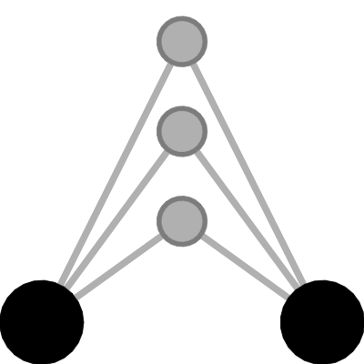{height="130px"}

### Shared partners

`gwdsp`

"We know the same people"
:::

::: {.column width="20%" .fragment}
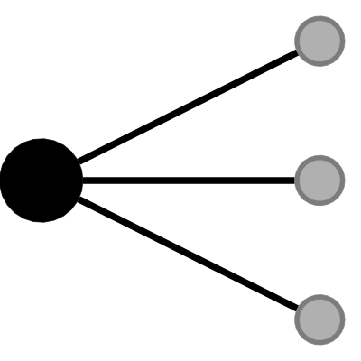{height="130px"}

### Popularity

`gwdegree`

"Some have many ties"
:::
:::

::: {.fragment}
And always **edges**, $\sum_{i\neq j} y_{ij}$: how many ties there are. It plays the role of the intercept.
:::

::: {.fragment style="font-size: 85%; color: #666;"}
The last three are **geometrically weighted**: each additional shared partner (or tie) counts a little less than the one before, which behaves better than raw counts of triangles and stars [@snijders_new_2006]. Figures drawn with `tabulergm` [@tabulergm].
:::


## ERGMs {.compact}

<!-- [2:00 | 9:00] The "ERGMs" slide of the nsi-sep2026 deck, in the paper's
     notation. -->

ERGMs provide a parametric representation of the distribution of $\graph \in \GRAPH$.

::: {style="font-size: 80%"}
$$
\begin{aligned}
\Pr{\GRAPH}{\Graph = \graph; \params} & = \frac{\exp{\t{\params}\textcolor{green}{\s{\graph}}}}{\textcolor{red}{\normconst{\params}}},\quad\graph \in\GRAPH \\
\textcolor{red}{\normconst{\params}} & = \sum_{\graph'\in\GRAPH}\exp{\t{\params}\textcolor{green}{\s{\graph'}}}
\end{aligned}
$$
:::

::: {.incremental}
- $\textcolor{green}{\s{\graph}}$ is the key: it captures the essential features of the network structure.
- $\textcolor{red}{\eta}$ (the normalizing constant)[^ergmitos] is intractable for most networks, so estimation requires simulation.
- Simulation is efficient via the **conditional distribution** of a dyad given the rest of the network (a logit model!):

::: {style="font-size: 80%" .fragment}

$$
\Prcond{\GRAPH}{\Graph_{ij}{=}1}{\Graph_{-ij}; \params}
= \frac{1}{1 + \exp{-\t{\params}\textcolor{purple}{\delta_{ij}}}}
$$

where [$\textcolor{purple}{\delta_{ij} = \s{\Graph_{ij}^{+}} - \s{\Graph_{ij}^{-}}}$]{style="font-size: 80%"} is how much each statistic changes when the tie $i \to j$ is added.
:::

:::

[^ergmitos]: Unless you care about small networks (which we do: @yon2019exponential; @ergmito; @defm; @vegayonDiscreteExponentialFamilyModels2022).


## Reading the coefficients {.semi data-menu-title="Interpretation"}

<!-- [1:00 | 10:00] The bridge to something the audience already knows. -->

Because the conditional is a logit, each coefficient is a **log-odds ratio**, holding the rest of the network fixed:

::: {.incremental}
- $\theta_{\text{homophily}} = 1$: a tie between two alike nodes has $e^{1} \approx 2.7$ times the odds of a tie between two unlike ones.
- $\theta_{\text{mutual}} = 2$: a tie that reciprocates an existing one has $e^{2} \approx 7.4$ times the odds.
- $\theta_{\text{edges}} = -3$: the baseline. A tie that creates nothing else has probability $\approx 0.05$.
:::

::: {.takeaway .fragment}
A logistic regression in which each tie's predictors are the other ties.
:::


## An ERGM, live {.compact data-menu-title="Demo: ERGM"}

<!-- [2:00 | 10:30] Press Run. Raise homophily: the colors separate. Raise
     mutual: arrows pair up. Then push edges up and watch it fill -- that is
     the segue to degeneracy. -->

```{=html}
<div class="ergm-widget" id="ergm-demo" style="font-size: 130%;"></div>
<script>ERGMWidget.mount(
  document.getElementById("ergm-demo"), {
    height: 400,
    model: ["edges", "nodematch", "mutual"],
    theta: {edges: -3, nodematch: 0, mutual: 0},
    stepsPerFrame: 20,
    n: 60,
    controls: {n: false, meanDegree: false}
    }
);</script>
```

$$
\Pr{\GRAPH}{\Graph = \graph; \params} = \frac{\exp{\theta_{\text{edges}}\,\sk{\graph}{\text{edges}} + \theta_{\text{homophily}}\,\sk{\graph}{\text{homophily}} + \theta_{\text{mutual}}\,\sk{\graph}{\text{mutual}}}}{\normconst{\params}}
$$

::: {.takeaway}
Simulating is easy: revisit one pair at a time with the logistic formula. The normalizing constant never shows up.
:::


## Fitting is the hard part {.semi data-menu-title="Estimation"}

<!-- [1:30 | 12:00] -->

::: {.columns}
::: {.column width="55%"}
The normalizing constant adds over **every possible network**:

$$
\normconst{\params} = \sum_{\graph' \in \GRAPH} \exp{\t{\params}\s{\graph'}}
$$

::: {.incremental}
- A directed network with $n$ nodes has $2^{n(n-1)}$ possible configurations. With $n = 10$, that is $2^{90} \approx 10^{27}$.
- So the likelihood is **approximated by simulation** (Markov chain Monte Carlo maximum likelihood, MCMC-MLE).
:::
:::

::: {.column width="45%" .fragment}
**The loop**

1. Guess $\params$.
2. Simulate networks from the model at $\params$.
3. Compare their statistics with the observed ones.
4. Update $\params$; go back to 2.
:::
:::

::: {.takeaway .fragment}
This only works if the simulated networks look something like the observed one. Often they do not.
:::


## Degeneracy {.compact data-menu-title="Degeneracy"}

<!-- [2:00 | 14:00] Figure 1 of the proposal. Point at the two corners. -->

::: {.columns}
::: {.column width="50%"}
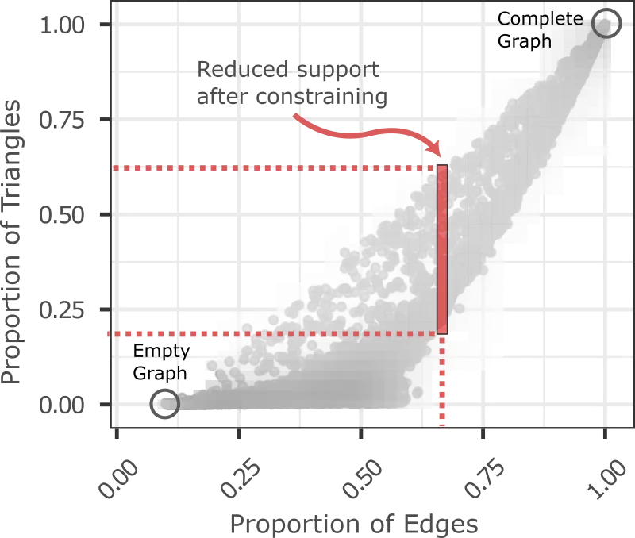{width="95%"}
:::

::: {.column width="50%" .incremental}
- Each dot is a possible network: its share of ties (x) and of triangles (y).
- For many parameter values, the model puts nearly all its probability on the **empty** or the **complete** network [@schweinberger_instability_2011].
- A small change in $\params$ flips it from one corner to the other.
- The simulation step then returns networks that look nothing like the data, and the fit **fails or never converges**.

::: {.takeaway .fragment}
The trouble runs along one direction: **the number of ties**. What if we take that direction away?
:::
:::
:::


# Part 2 -- Conditioning on the edge count {background-color="#00707a"}

## Fix what you do not want to model {.compact data-menu-title="Conditional ERGM"}

<!-- [2:00 | 17:00] k is the edges term; c is the observed number of ties. -->

Let $\sk{\graph}{k}$ be the number of ties. Only consider networks with **exactly as many ties as the one we observed**, $\textcolor{#c0491f}{c}$:

::: {style="font-size: 85%"}
$$
\Prcond{\GRAPH}{\Graph = \graph}{\sk{\Graph}{k} = \textcolor{#c0491f}{c};\ \params}
= \frac{\exp{\t{\params}\s{\graph}}}{\normconst{\params \mid \sn{k} = \textcolor{#c0491f}{c}}}
= \frac{\exp{\theta_{k}\textcolor{#c0491f}{c}}\;\exp{\t{\params_{-k}}\sk{\graph}{-k}}}
       {\exp{\theta_{k}\textcolor{#c0491f}{c}}\;\sum_{\graph' \in \GRAPH:\, \sk{\graph'}{k} = c}\exp{\t{\params_{-k}}\sk{\graph'}{-k}}}
= \frac{\exp{\t{\params_{-k}}\sk{\graph}{-k}}}{\normconst{\params_{-k} \mid \sn{k} = \textcolor{#c0491f}{c}}}
$$
:::

::: {style="font-size: 85%; color: #666;"}
$\normconst{\params \mid \sn{k} = c} = \sum_{\graph' \in \GRAPH:\, \sk{\graph'}{k} = c} \exp{\t{\params}\s{\graph'}}$ is the normalizing constant over the networks with $c$ ties; $-k$ means "all terms but the $k$-th".
:::

::: {.incremental}
- The edges coefficient, $\theta_k$, **cancels**. There is one parameter less, and it is the troublesome one.
- The empty and the complete network are no longer possible outcomes.
- It is the idea behind **conditional logistic regression** (matched case--control studies), applied to networks [@snijders_conditional_2010; @pattison_conditional_2013].
- Sometimes it is simply the truth: surveys that cap the number of friends you can name, or brain networks thresholded to a fixed density.
:::

::: {.takeaway .fragment}
With several networks, each keeps its own edge count, so every network's density drops out at once.
:::


## The conditional model, live {.compact data-menu-title="Demo: conditional"}

<!-- [1:30 | 17:30] Press Run and read the stats box: "edges" never moves.
     Each step moves one tie from an occupied pair to an empty one. The mean
     out-degree slider + Reset sets the (fixed) number of ties. -->

```{=html}
<div class="ergm-widget" id="ergm-demo-cond" style="font-size: 130%;"></div>
<script>ERGMWidget.mount(
  document.getElementById("ergm-demo-cond"), {
    height: 400,
    model: ["nodematch", "mutual"],
    theta: {nodematch: 0, mutual: 0},
    constraint: "edges",
    stepsPerFrame: 20,
    n: 60,
    meanDegree: 4,
    controls: {n: false, meanDegree: true}
    }
);</script>
```

Same model, no edges term. Each step **moves** a tie instead of adding or deleting one:

$$
\Pr{}{\text{accept the move}} = \min\left\{1,\ \exp{\t{\params_{-k}}\left[\sk{\graph_{\text{new}}}{-k} - \sk{\graph_{\text{old}}}{-k}\right]}\right\}
$$

::: {.takeaway}
The number of ties never changes, so the chain cannot drift to the empty or the complete network.
:::


## What could it cost? {data-menu-title="The two questions"}

<!-- [1:30 | 20:00] The factorization as written in the paper. This is the
     spine of the rest of the talk. -->

The full model is the conditional model **times** the model for the edge count:

$$
\Pr{\GRAPH}{\Graph = \graph; \params} =
\underbrace{\frac{\exp{\t{\params}\s{\graph}}}{\normconst{\params \mid \sn{k} = c}}}_{\text{Conditional}}
\times
\underbrace{\frac{\normconst{\params \mid \sn{k} = c}}{\normconst{\params}}}_{\text{Marginal: how many ties}}
$$

Fitting only the first factor throws the second away. Maximizing one is **not** the same as maximizing the product.

::: {.columns}
::: {.column width="50%" .fragment}
### Question 1

Does the edge count tell us anything about $\params_{-k}$?

*How much **information** do we lose?*
:::

::: {.column width="50%" .fragment}
### Question 2

When we actually fit both models, which one **converges**, how **fast**, and how **accurate** is it?
:::
:::


## One design for both questions {.compact data-menu-title="Study design"}

<!-- [1:00 | 20:00] Do NOT read the table. Three things: seven models, small
     networks in groups of 1 to 20, truth is known because we simulate. -->

We simulate networks from the **full** ERGM (so the unconditional model is the correct one), with known coefficients.

::: {.columns}
::: {.column width="52%"}
| Model | Terms besides edges |
|:--|:--|
| Directed | homophily + mutual + **gwesp** |
| Directed | homophily + mutual + **gwdsp** |
| Directed | homophily + mutual + **gwesp $\times$ size** |
| Undirected | homophily + **gwesp** |
| Undirected | homophily + **gwesp + gwnsp** |
| Undirected | homophily + **gwdegree + gwesp** |
| Undirected | homophily + **gwesp, decay estimated** |
:::

::: {.column width="48%" .incremental}
- **Samples of $M$ networks**, $M \in \{1, 5, 10, 20\}$, as in multi-site or multi-classroom studies.
- **Sizes** from 10 to 100 nodes.
- **Densities** from 0.05 to 0.5.
- **Coefficients** drawn anew for every sample, from $\pm U(1, 2)$: positive and negative effects, all of them strong.
- **500 replicates** per model and $M$.
- Edges coefficient decreasing with $\text{log}\,n$ [@krivitsky_adjusting_2011].
:::
:::

::: {style="font-size: 85%; color: #666;"}
`gwesp`: shared partners of connected pairs (triangles). `gwdsp` / `gwnsp`: shared partners of all / unconnected pairs (two-paths). `gwdegree`: degree distribution. The undirected models follow brain-network applications.
:::


# Part 3 -- How much information do we lose? {background-color="#00707a"}

## Splitting the log-likelihood {.semi data-menu-title="Likelihood decomposition"}

<!-- [2:00 | 23:00] Everything in this part is evaluated AT the true
     parameter, by simulation only -- no model is fit. -->

Taking logs of the factorization, at the **true** parameter:

$$
\loglik{\params} \;=\;
\underbrace{\t{\params}\s{\graph} - \log{\normconst{\params \mid \sn{k} = c}}}_{l_{\text{cond}}:\ \text{which network, given its edge count}}
\;+\;
\underbrace{\log{\normconst{\params \mid \sn{k} = c}} - \log{\normconst{\params}}}_{l_{\text{marg}}:\ \text{the edge count}}
$$

::: {.incremental}
- No model is fit here. We only **simulate** at the true parameter, on the same networks as the main experiment ($M = 1$ and $5$).
- The marginal piece is about **$-4$ nats per network** at every density: the observed edge count has probability $\approx e^{-4} \approx 0.02$.
- $l_{\text{cond}}$ runs in the **hundreds to thousands** of nats: it grows with the number of pairs, the marginal piece with its logarithm.
:::

::: {.takeaway .fragment}
The edge count carries a fraction of a percent of the log-likelihood. But that is mostly size. The real question is what it says about the **coefficients**.
:::


## The right yardstick: Fisher information {.compact data-menu-title="Information identity"}

<!-- [2:00 | 25:00] Say it in words: the full model ALREADY pays for not
     knowing the edges coefficient. The fair comparison is against that. -->

How precisely can each model pin down $\params_{-k}$? Write $S_k = \sk{\Graph}{k}$ for the edge count and $S_{-k} = \sk{\Graph}{-k}$ for the other statistics.

::: {.columns}
::: {.column width="50%" .fragment}
### Full model

It must also estimate $\theta_{k}$, which costs precision. What is left is the **efficient information**:

$$
I_{\text{eff}} = \Var{S_{-k}} - \frac{\Cov{S_{-k}}{S_k}\,\Cov{S_k}{S_{-k}}}{\Var{S_k}}
$$
:::

::: {.column width="50%" .fragment}
### Conditional model

The variability of the statistics **within** an edge count, averaged over edge counts:

$$
I_{\text{cond}} = \Expected{\VarCond{S_{-k}}{S_k}}
$$
:::
:::

::: {.fragment}
The difference is exact, with $m(S_k) = \ExpectedCond{S_{-k}}{S_k}$ and $B$ the slope of $S_{-k}$ on $S_k$:

$$
I_{\text{eff}} - I_{\text{cond}} = \Var{m(S_k) - B\,S_k}
$$
:::

::: {.takeaway .fragment}
Conditioning loses information only where the expected statistics **bend** with the edge count. A strong but linear relation costs nothing. See the [\<algebra\>](#information-algebra).
:::


## Results: triangles lose almost nothing {.results background-color="#fdf6f2" .compact data-menu-title="Information: mutual + gwesp"}

<!-- [1:30 | 25:30] Line = median sample, band = 10th to 90th percentile. -->

::: {.columns}
::: {.column width="62%"}
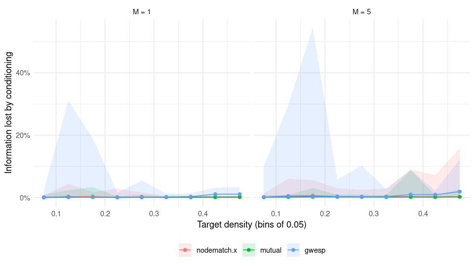{width="100%"}

::: {style="font-size: 80%; color: #666;"}
Directed model with homophily, mutual and gwesp. Line: median sample. Band: 10th to 90th percentile. 500 samples per panel.
:::
:::

::: {.column width="38%" .incremental}
- The **median loss is at most 1.2%** for every coefficient, at every density.
- Homophily and reciprocity: nothing to see.
- The band for `gwesp` opens in **sparse** networks: in the worst cell, 18% of samples lose more than 5%.
- More networks ($M = 5$) do not make it go away.
:::
:::

::: {.takeaway .fragment}
In the typical sample, the edge count knows nothing about clustering, homophily or reciprocity that the rest of the network does not.
:::


## Results: but it depends on the term {.results background-color="#fdf6f2" .compact data-menu-title="Information: all models"}

<!-- [2:00 | 27:30] Read top to bottom: the first four blocks hug zero, the
     bottom four do not. -->

::: {.columns}
::: {.column width="70%"}
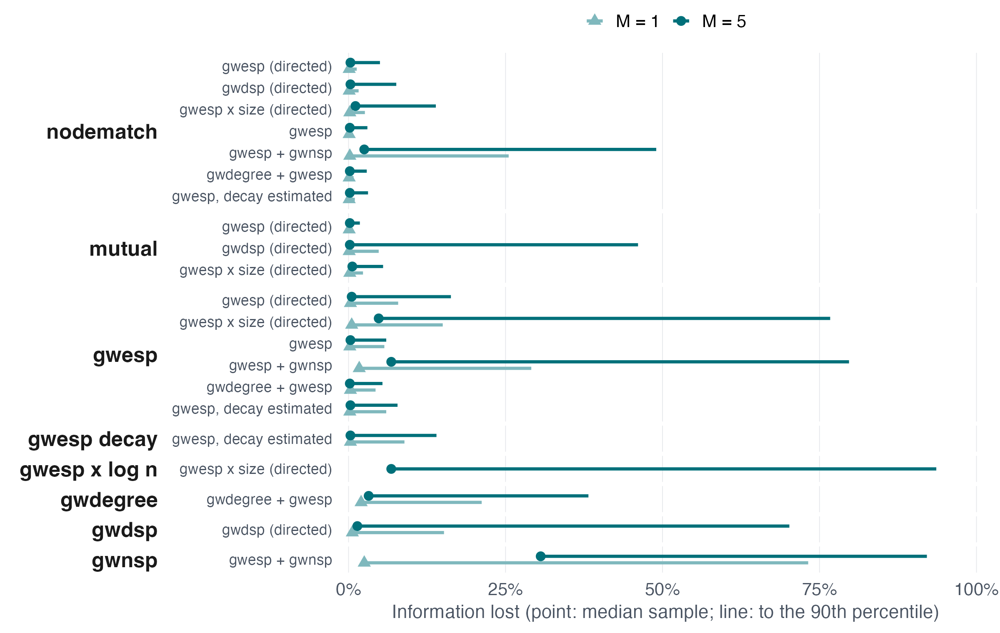{width="100%"}
:::

::: {.column width="30%"}
::: {.fragment}
### Loses little

`gwesp`, homophily and reciprocity: median below 1%.
:::

::: {.fragment}
### Loses more

`gwnsp` (median **31%** with five networks), `gwdsp`, `gwdegree`, and a `gwesp` effect that varies with network size.
:::

::: {.fragment}
### Why

Two-paths and degrees grow with the **square** of the edge count: that is the bend.
:::
:::
:::


## How far to trust these numbers {.compact data-menu-title="Information: checks"}

<!-- [1:30 | 29:00] -->

::: {.columns .cols-gap}
::: {.column width="50%"}
### What holds up

::: {.incremental}
- **Exact check.** On networks of 4 to 7 nodes we can enumerate every graph. The estimator matches the exact value in all seven models (median absolute error 0.002--0.012).
- **Longer chains.** Eight times the simulation effort moves the results by at most 0.01, except for `gwdsp`, whose tail gets slightly worse (70% $\to$ 76%).
:::
:::

::: {.column width="50%"}
### What does not (yet)

::: {.incremental}
- **Not identified.** In up to a fifth of the samples a coefficient has no information at all under *either* model: the drawn coefficients freeze the network.
- **$l_{\text{cond}}$ itself** is not estimated reliably when the clustering coefficient is negative; the simulation path behaves like a phase transition. See the [\<details\>](#conditional-bridges).
- **Local.** Information at the truth is about precision in large samples. It says nothing about bias or about whether a fit converges.
:::
:::
:::

::: {.takeaway .fragment}
So far: for the most common specification, conditioning is nearly free on paper. Does that survive actual fitting?
:::


# Part 4 -- Does it work in practice? {background-color="#00707a"}

## Two ways to fit the same networks {.semi data-menu-title="Simulation: arms"}

<!-- [1:30 | 30:30] -->

::: {.columns}
::: {.column width="50%"}
### Unconditional

- Estimates edges and its size effect, as in the model that generated the data.
- The **correctly specified** model: this is its home turf.
:::

::: {.column width="50%"}
### Conditional

- Drops edges; fixes **each network's** edge count.
- Needs a new sampler: move a tie *within* a network (`condergm`, built on `ergm` and `ergm.multi`).
:::
:::

::: {.incremental}
- Both fit by **MCMC-MLE** with the `ergm` R package, from the **same starting values**, with a one-hour limit per fit.
- A fit **fails** if it times out, errors, or returns a non-finite estimate or standard error.
- Among the fits that converge: **bias** and **median absolute error** of the geometrically weighted coefficients, and **coverage** of the 95% confidence intervals.
- Seven models $\times$ four values of $M$ $\times$ 500 replicates, fit both ways on the University of Utah's cluster.
:::


## Results: the short version {.results background-color="#fdf6f2" .compact data-menu-title="Simulation: headline"}

<!-- [1:30 | 32:00] Table 2 of the report, last row. -->

All models and sample sizes pooled (10,179 samples, each fit both ways):

::: {.findings-grid .headline}

::: {.finding .fragment}
### <br>Converges more often

[**62%** vs 55%]{.badge .badge-strong}

In every one of the seven models
:::

::: {.finding .fragment}
### <br>Faster

[**31 s** vs 56 s]{.badge .badge-strong}

About half the time with five or more networks
:::

::: {.finding .fragment}
### <br>Just as accurate

[**0.15** vs 0.16]{.badge .badge-strong}

Median absolute error; bias 0.01 in both
:::

::: {.finding .fragment}
### <br>Honest intervals

[**92%** vs 90%]{.badge .badge-strong}

Coverage of 95% intervals
:::

:::

::: {.takeaway .fragment}
The conditional model matches or beats the correctly specified one on every measure, in a comparison designed to favor the unconditional model.
:::

::: {.absolute bottom="0" right="0" style="font-size: 80%; color: #666;"}
Conditional vs. unconditional. Accuracy and coverage among converged fits.
:::


## Results: more networks, same story {.results background-color="#fdf6f2" .compact data-menu-title="Simulation: by M"}

<!-- [1:30 | 33:30] The third panel is the consistency picture. -->

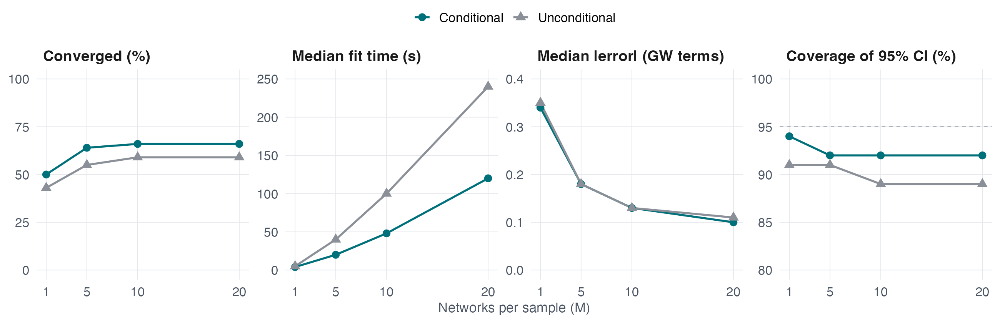{width="100%"}

::: {.incremental}
- **Consistency.** The error falls from 0.34 with one network to 0.10 with twenty, at the same rate in both models.
- **Time.** The gap widens with $M$: 2 minutes against 4 with twenty networks.
- **Coverage.** The unconditional intervals get slightly too narrow as $M$ grows; the conditional ones hold at 92%.
:::


## Results: model by model {.results background-color="#fdf6f2" .compact data-menu-title="Simulation: by model"}

<!-- [1:30 | 35:00] -->

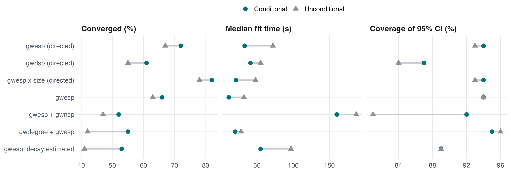{width="100%"}

::: {.incremental}
- The gain in convergence is largest where fitting is hardest: degree terms (+13 points) and an estimated decay (+12 points).
- With `gwesp + gwnsp`, the unconditional intervals cover the truth 81% of the time; the conditional ones, 92%.
- Recall part 3: `gwnsp` was the term that **lost the most information**. It does not show up as worse estimates here.
:::


## Where both models struggle: density {.compact data-menu-title="Simulation: density"}

<!-- [1:30 | 36:30] Table 3c of the report + appendix A1. -->

::: {.columns}
::: {.column width="60%"}
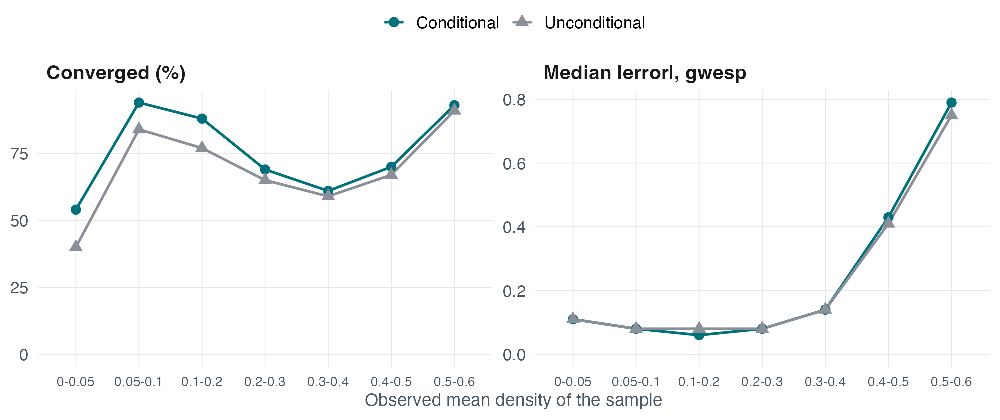{width="100%"}

::: {style="font-size: 80%; color: #666;"}
Directed model with homophily, mutual and gwesp; all $M$.
:::
:::

::: {.column width="40%" .incremental}
- Conditioning helps most in **sparse** networks, where observed networks usually are.
- Above a density of about 0.4, the error grows **in both models**.
- In a dense network every tie has many shared partners, so the weighted count is nearly a multiple of the edge count.
- With the edge count fixed, the standard deviation of `gwesp` in 55-node networks goes from 12 (density 0.2) to 1 (0.4) to 0.004 (0.6).
:::
:::

::: {.takeaway .fragment}
This is not a failure of conditioning: there is nothing left to estimate. See [\<densities above 0.5\>](#dense-networks).
:::


## Why fits fail {.compact data-menu-title="Simulation: failures"}

<!-- [1:30 | 38:00] Tables 3b and 8b of the report. -->

Share of fits by cause of failure, range over $M \in \{1, 5, 10, 20\}$:

| Model | Cause | Unconditional | Conditional |
|:--|:--|--:|--:|
| Directed, `gwesp` | Chain did not mix | 3--8% | **0--1%** |
| | Non-finite standard error | 15--32% | 17--32% |
| | Timed out | 1--8% | 2--5% |
| Undirected, `gwdegree + gwesp` | Chain did not mix | 24--36% | **0--21%** |
| | Non-finite standard error | 20--35% | 25--39% |
| | Timed out | 1--5% | 5--12% |

::: {.incremental}
- Conditioning nearly removes the failures in which **the chain does not mix**: the degeneracy story of part 1.
- It does nothing for **non-finite standard errors**. Those are mostly samples whose coefficients cannot be estimated by either model (the "not identified" samples of part 3).
- Still, 38% of conditional fits fail. Strong coefficients in small networks are a hard test by design.
:::


# Closing {background-color="#00707a"}

## Does conditioning on edge counts help? {.compact data-menu-title="Summary"}

<!-- [1:00 | 39:00] -->

::: {.columns .cols-gap}
::: {.column width="50%"}
### Yes

::: {.incremental}
- It **converges more often**, in about **half the time**.
- It is **as accurate** as the correctly specified full model, with intervals at least as good.
- For clustering (`gwesp`), homophily and reciprocity, it keeps **99% of the information** in the typical sample.
:::
:::

::: {.column width="50%"}
### But

::: {.incremental}
- Terms that bend with the edge count (`gwnsp`, `gwdsp`, `gwdegree`, size-varying effects) can lose a lot of information.
- It does not rescue coefficients that are **not identified**, nor dense networks.
- You no longer get a model for density. Simulating new networks needs the edge count from somewhere.
:::
:::
:::

::: {.takeaway .fragment}
If density is a nuisance in your question, do not estimate it. If it is the question, a conditional fit is still a cheap and stable place to start.
:::


## What comes next {.compact .where-next data-menu-title="Next steps"}

<!-- [1:00 | 40:00] -->

:::: {.columns}

::: {.column width="33%" .fragment}
###  Larger networks

Single networks with 500 and 1,000 nodes, where the unconditional model is at its slowest. The runs are in progress.

Why the information loss for `gwnsp` does not turn into worse estimates.
:::

::: {.column width="33%" .fragment}
###  Seeding

Use the conditional fit as the **starting point** of the full model:

1. Fit the conditional model.
2. Fit only edges, the rest held fixed.
3. Start the full fit from there.

See a [\<proof of concept\>](#seeding-proof-of-concept).
:::

::: {.column width="33%" .fragment}
###  Power and data

How many networks does a study need? Conditional models make the simulations behind a power analysis feasible ([\<example\>](#power-analysis)).

Applications: brain networks from fMRI, gene-interaction networks.
:::

::::

::: {.fragment style="margin-top: 1em;"}
All of it as open-source R packages built on `ergm`.
:::


## Thank you! {.center data-menu-title="Thank you"}

::: {.columns}

::: {.column width="50%"}
::: {style="font-size: 1.3em;"}
Conditional Exponential-Family Random Graph Models
:::

::: {style="font-size: 0.9em; color: #666;"}
**George G. Vega Yon, Ph.D.**

Division of Epidemiology<br>University of Utah

 <https://ggvy.cl>
:::
:::

::: {.column width="50%"}
<!-- Same research map as the opening slide: bookends the talk and leaves
     the collaboration areas on screen during questions. -->
```{mermaid}

```
:::

:::


# Appendix {visibility="uncounted" background-color="#00707a"}

## The information identity {#information-algebra .compact visibility="uncounted" data-menu-title="Information: algebra"}

One network, edges coefficient $\theta_k$ unknown. $S_k = \sk{\Graph}{k}$: edge count; $S_{-k} = \sk{\Graph}{-k}$: the other statistics; $m(S_k) = \ExpectedCond{S_{-k}}{S_k}$; $B = \Cov{S_{-k}}{S_k} / \Var{S_k}$.

1. The law of total covariance gives $\Var{S_{-k}} = \Expected{\VarCond{S_{-k}}{S_k}} + \Var{m(S_k)} = I_{\text{cond}} + \Var{m(S_k)}$.

2. Since $\Cov{m(S_k)}{S_k} = \Cov{S_{-k}}{S_k}$,

$$
\Var{m(S_k) - B S_k} = \Var{m(S_k)} - B\,\Var{S_k}\,\t{B}.
$$

3. Subtracting,

$$
I_{\text{eff}} - I_{\text{cond}} = \Var{S_{-k}} - B\,\Var{S_k}\,\t{B} - I_{\text{cond}} = \Var{m(S_k) - B S_k} \succeq 0.
$$

::: {.incremental}
- No orthogonality between edges and the other parameters is needed: the cancellation is exact.
- If $S_{-k}$ itself is a linear function of $S_k$, both sides are zero: equal information does not mean the coefficient can be estimated.
- With several networks and a shared size effect, the full sample's information is assembled first and the nuisance block removed once.
:::

::: {.absolute bottom="0" right="0" style="font-size: 80%; color: #666;"}
Go [\<back\>](#the-right-yardstick-fisher-information)
:::


## Estimating the conditional log-likelihood {#conditional-bridges .compact visibility="uncounted" data-menu-title="Conditional bridges"}

$l_{\text{cond}}$ needs $\normconst{\params \mid \sn{k} = c}$, a sum over all networks with $c$ edges. We bridge from the uniform distribution ($\params_{-k} = 0$, where the sum is known) to the true parameter, forward and in reverse. If a chain only lags, the two directions bracket the value and the gap closes with effort.

| Networks (10 each) | Gap, effort $\times 1$ | $\times 8$ | $\times 64$ |
|:--|--:|--:|--:|
| Positive `gwesp` | 1.24 | 0.21 | 0.09 |
| Negative `gwesp` | 179 | 94 | 76 |
| Negative `gwesp`, $\hat{l}_{\text{cond}} > 0$ | 2,613 | 2,414 | 2,318 |

::: {style="font-size: 85%; color: #666;"}
Median gap between the forward and reverse bridges, in nats.
:::

- With fewer triangles than chance at a fixed edge count, the forward path does not cross: 362 of 2,999 networks had an impossible $l_{\text{cond}} > 0$, all with a negative `gwesp` coefficient.
- The information results do not use these bridges.

::: {.absolute bottom="0" right="0" style="font-size: 80%; color: #666;"}
Go [\<back\>](#how-far-to-trust-these-numbers)
:::


## Densities above 0.5 {#dense-networks .compact visibility="uncounted" data-menu-title="Dense networks"}

From an earlier design with target densities up to 0.9; all models and $M$ pooled.

| Terms | Density | Model | Converged | Median abs. error | Coverage |
|:--|:--|:--|--:|--:|--:|
| Geometrically weighted | 0.5--0.6 | Unconditional | 35% | 0.89 | 89% |
| | | Conditional | 44% | 1.40 | 93% |
| | 0.7--0.8 | Unconditional | 28% | 4.95 | 36% |
| | | Conditional | 14% | 14.30 | 95% |
| Homophily and mutual | 0.5--0.6 | Unconditional | 45% | 0.04 | 93% |
| | | Conditional | 55% | 0.04 | 95% |
| | 0.7--0.8 | Unconditional | 31% | 0.04 | 94% |
| | | Conditional | 20% | 0.05 | 95% |

- The weighted terms cannot be estimated by either model. The conditional model says so (wide intervals, 95% coverage); the unconditional one is confidently wrong.
- Homophily and reciprocity stay accurate at any density, whenever a fit converges.

::: {.absolute bottom="0" right="0" style="font-size: 80%; color: #666;"}
Go [\<back\>](#where-both-models-struggle-density)
:::


## Other estimation choices {.compact visibility="uncounted" data-menu-title="SA and starting values"}

::: {.columns .cols-gap}
::: {.column width="50%"}
### Stochastic approximation

Fit in an earlier design and dropped:

- It converged 15--25 points more often than MCMC-MLE.
- Its errors on the weighted coefficients were 25--45% larger.
- Its standard errors were too small: coverage of 76--88%.
- Conditioning made it **slower**, and it failed more often than the unconditional version.
:::

::: {.column width="50%"}
### Starting values

By default, `ergm` starts unconditional fits from the pseudo-likelihood estimate and conditional ones from contrastive divergence.

- Here, both models start from the same point.
- Sharing the start helped the conditional model with `gwdsp` and `gwesp + gwnsp`, and hurt it with `gwdegree`.
:::
:::


## Seeding: proof of concept {#seeding-proof-of-concept .compact visibility="uncounted" data-menu-title="Seeding"}

One network with 100 nodes, from a model with edges, triangles and homophily ($\params = \{-6.0, 1.25, 2.5\}$). Stochastic approximation, started two ways.

::: {.columns}
::: {.column width="45%"}
| | Default start | Conditional start |
|:--|--:|--:|
| Edges | $-3.15$ | $-3.29$ |
| Triangles | $-0.05$ | $0.04$ |
| Homophily | $1.06$ | $2.00$ |
| Log-likelihood | $-6{,}054$ | $-4{,}102$ |

The default MCMC-MLE did not return a fit.
:::

::: {.column width="55%"}
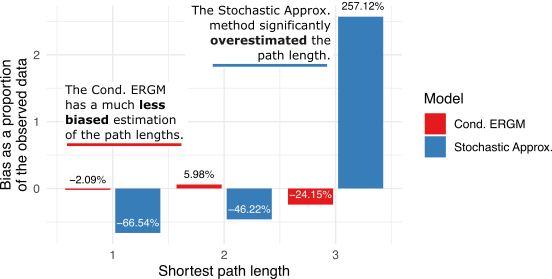{width="100%"}
:::
:::

::: {.absolute bottom="0" right="0" style="font-size: 80%; color: #666;"}
Go [\<back\>](#what-comes-next)
:::


## Power analysis {#power-analysis visibility="uncounted" data-menu-title="Power"}

> How many networks do you need to detect a homophily effect? --<br> [@vegayonPowerMulticollinearitySmall2023a in JASA]

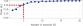{width=65% .nostretch}

::: {.absolute bottom="0" right="0" style="font-size: 80%; color: #666;"}
Go [\<back\>](#what-comes-next)
:::


## References {visibility="uncounted" .smaller}

::: {#refs}
:::
