## Today {data-menu-title="Roadmap"}

```{r}
#| label: setup
# Every table and result number of the deck comes from data/ through these
# helpers; data/README.md says how data/ is built.
source("scripts/deck.R")
```

::: {.hidden}
$$

$$
:::


::: {.incremental}
1. **Statistical inference in networks**
2. **Conditioning on the edge count.**
3. **How much information do we lose?**
4. **Does it work in practice?**
:::

::: {.absolute bottom="0" right="0" style="font-size: 80%; color: #666;"}
Supported by NLM/NIH Award Number R21LM015164. The content is solely the responsibility of the authors and does not necessarily represent the official views of the NIH.
:::

# Part 1 -- Statistical inference in networks {background-color="#00707a"}


## Public health: physicians who share patients {.compact data-menu-title="Application: physician networks"}

::: {.columns}
::: {.column width="58%"}
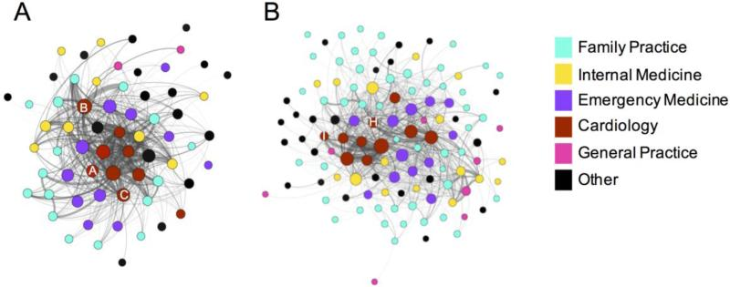{width="100%"}
:::

::: {.column width="42%"}
**Question:** do physicians share patients with others of the **same specialty** (homophily), and does the network explain differences in evidence-based care?

**ERGM:** edges + degree + homophily on specialty and other traits, one network per hospital.

::: {.fragment}
**But:** "ERGMs do not converge or yield plausible estimates for our physician network when including [...] geometric weighted edgewise shared-partner network statistics" [@moen_analysis_2016].

So clustering was left out.
:::
:::
:::


## Neuroscience: whole-brain connectivity {.compact data-menu-title="Application: brain networks"}

::: {.columns}
::: {.column width="55%"}
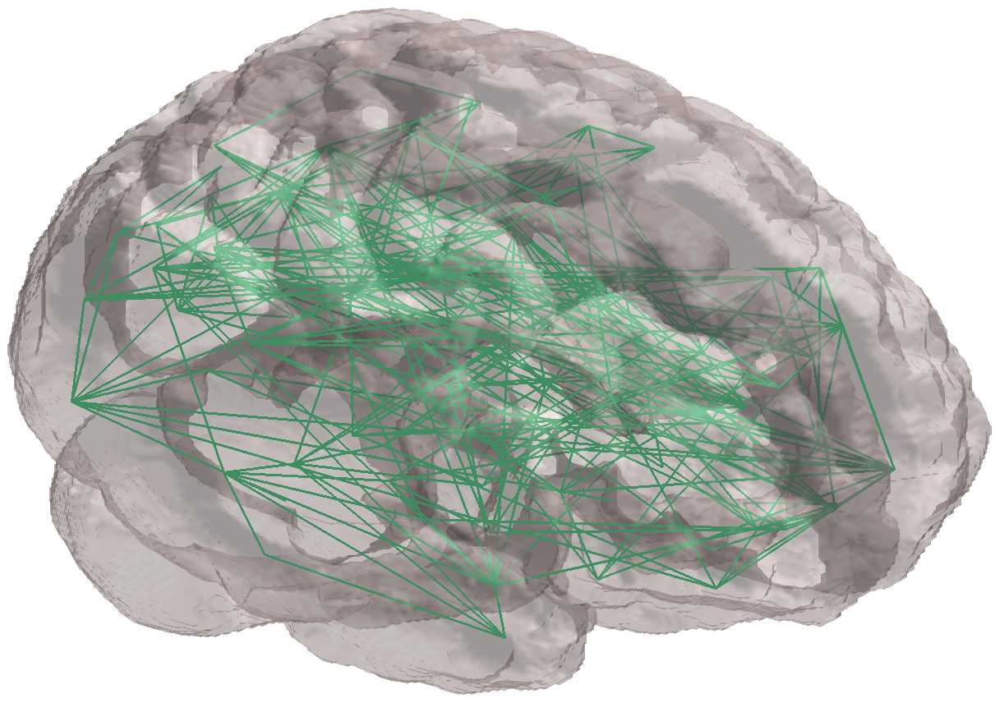{width="100%"}
:::

::: {.column width="45%"}
**Question:** which local patterns produce the brain's global organisation?

**Finding:** after edges, **clustering** (`gwesp`) is the strongest term [@simpson_exponential_2011].

::: {.fragment}
**Many brains at once:** @lehmann_characterising_2021 fit ERGMs to the networks of a whole group (young vs older adults) and find group differences in `gwnsp`.

The networks come from **thresholding** correlations at a chosen average degree: the analyst, not the brain, sets the density.
:::
:::
:::


## Biology: gene regulation {.compact data-menu-title="Application: gene regulation"}

::: {.columns}
::: {.column width="62%"}
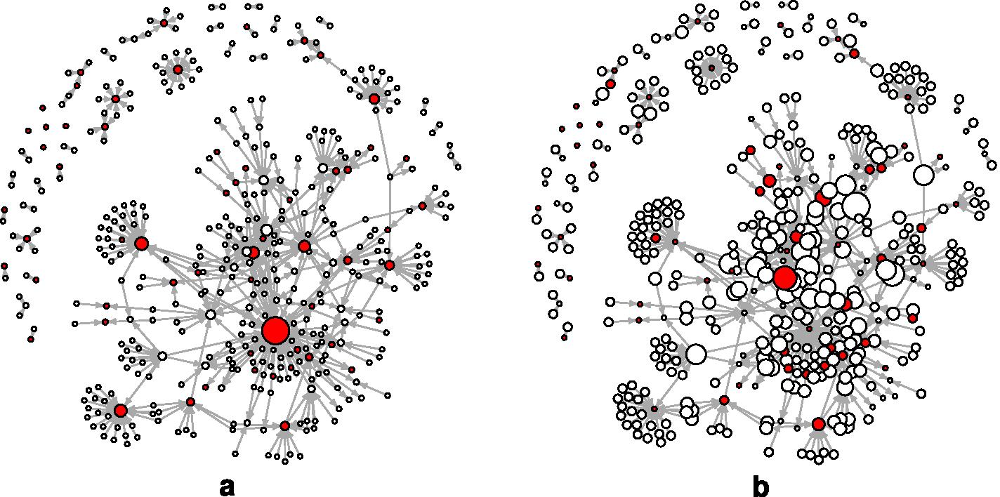{width="100%"}
:::

::: {.column width="38%"}
**Question:** are some motifs, such as the **feed-forward loop**, more common than chance?

**ERGM:** the motifs are model terms, tested together while accounting for degree.

**Finding:** feed-forward loops (transitive triangles) are over-represented in *E. coli* and yeast regulatory networks [@stivala_testing_2021].
:::
:::

::: {.takeaway .fragment}
Across fields, the question is the same: which local structures, explain the network? Those are the terms that make ERGMs hard to fit.
:::


## Many networks at once: pooled ERGMs {.compact data-menu-title="Application: pooled ERGMs"}

::: {.columns}
::: {.column width="45%"}
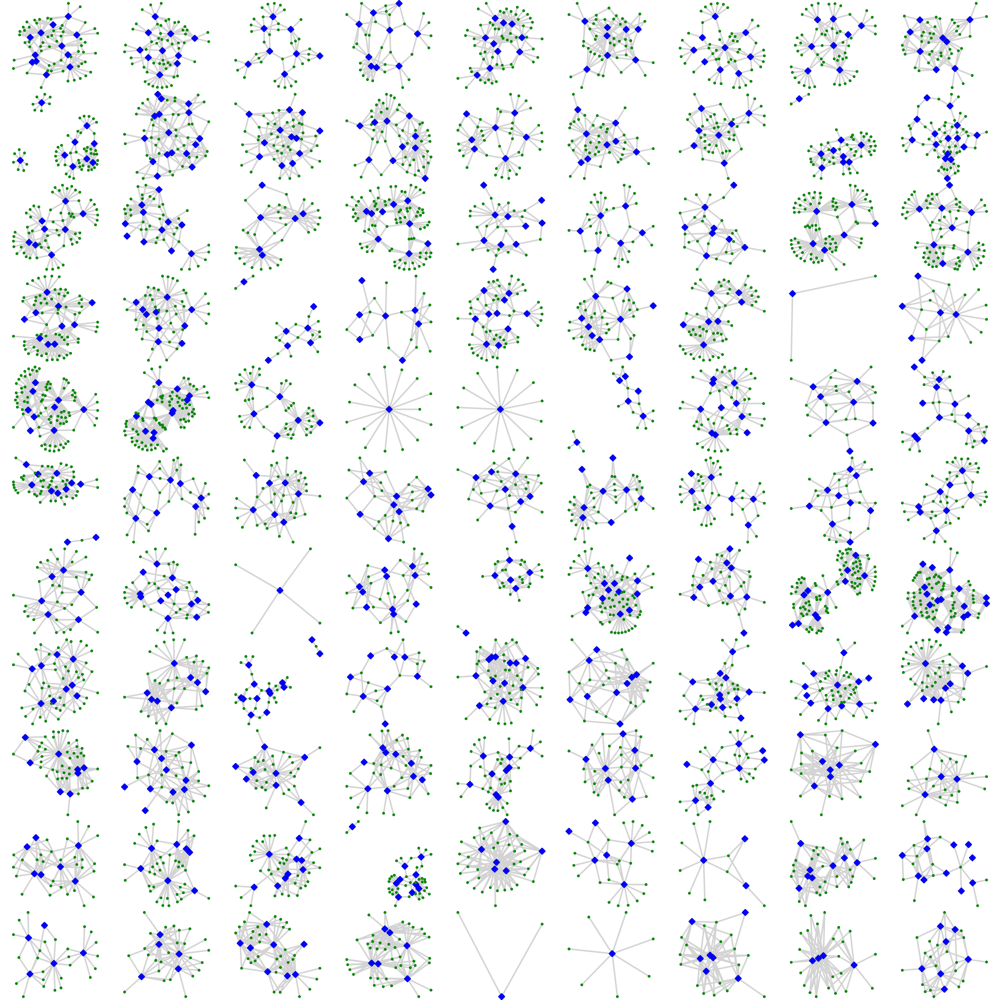{width="92%"}
:::

::: {.column width="55%"}
**Question:** do providers' contacts cluster residents with the same clinical risks (cohorting), e.g., drug-resistant organisms?

**One model, 93 networks:** a pooled (multilevel) bipartite ERGM. Heterogeneity across networks enters as interactions:

- edges × centred log number of residents and of providers,
- state-specific edges,
- shared partners (`gwdsp`) × log size.

**Finding:** residents with wound care, bedridden or on a ventilator have more contacts; no cohorting-like sharing by resistant-organism status [@vegayon_ltcf_2027].

:::
:::


## Sufficient Statistics: Counting Structures {.compact data-menu-title="Sufficient statistics"}


Each statistic counts a **local structure**. Its coefficient says whether the network has more or fewer of them than chance, given everything else in the model. Besides of the **edges** term (density), the most common are:

::: {.columns .terms-row}
::: {.column width="20%" .fragment}
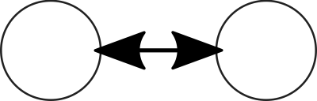{height="130px"}

### Mutual ties

`mutual`

"I name you, you name me"
:::

::: {.column width="20%" .fragment}
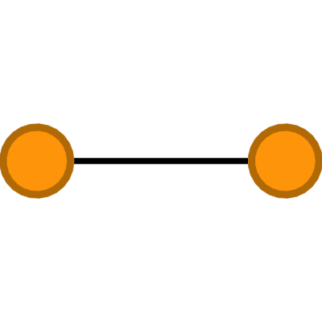{height="130px"}

### Homophily

`nodematch`

"We are alike"
:::

::: {.column width="20%" .fragment}
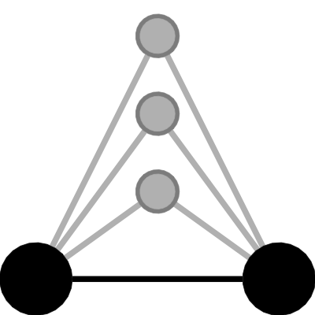{height="130px"}

### Closure

`gwesp`

"Our friends are friends"
:::

::: {.column width="20%" .fragment}
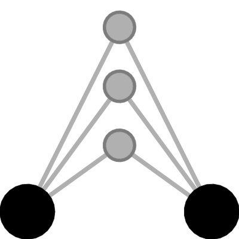{height="130px"}

### Shared partners

`gwdsp`

"We know the same people"
:::

::: {.column width="20%" .fragment}
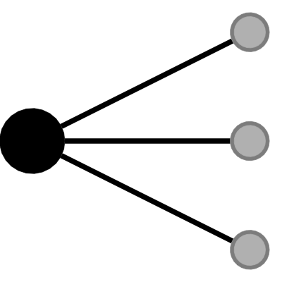{height="130px"}

### Popularity

`gwdegree`

"Some have many ties"
:::
:::

::: {.takeaway .fragment}
This is what Exponential-family Random Graph Models (ERGMs) do: they measure the **excess or deficit of local structures** 
:::

::: { style="font-size: 85%; color: #666;"}
The last three are **geometrically weighted**: each additional shared partner (or tie) counts a little less than the one before, which behaves better than raw counts of triangles and stars [@snijders_new_2006]. Figures drawn with `tabulergm` [@tabulergm].
:::

## ERGMs {.compact}

Exponential-family Random Graph Models (ERGMs or ERG Models) provide a parametric representation of the distribution of $\graph \in \GRAPH$.

::: {style="font-size: 80%"}
$$
\Pr{\GRAPH}{\Graph = \graph; \params} = \frac{\exp{\t{\params}\textcolor{green}{\s{\graph}}}}{\textcolor{red}{\normconst{\params}}},\quad\graph \in\GRAPH\qquad
\textcolor{red}{\normconst{\params}}  = \sum_{\graph'\in\GRAPH}\exp{\t{\params}\textcolor{green}{\s{\graph'}}}
$$
:::

::: {.incremental}
- $\textcolor{green}{\s{\graph}}$ is the key: it captures the essential features of the network structure.
- $\textcolor{red}{\eta}$ (the normalizing constant)[^ergmitos] is intractable for most networks-- $O\left(2^{n^2}\right)$ possible networks for $n$ nodes.
- Simulation is efficient via the **conditional distribution** of a dyad given the rest of the network (a logit model!):

::: {.fragment}

$$
\Prcond{\GRAPH}{\Graph_{ij}{=}1}{\Graph_{-ij}; \params}
= \frac{1}{1 + \exp{-\t{\params}\textcolor{purple}{\delta_{ij}}}}
$$

where [$\textcolor{purple}{\delta_{ij} = \s{\Graph_{ij}^{+}} - \s{\Graph_{ij}^{-}}}$]{style="font-size: 80%"} is how much each statistic changes when the tie $i \to j$ is added.
:::

:::

[^ergmitos]: Unless you care about small networks (which we do: @yon2019exponential; @ergmito; @defm; @vegayonDiscreteExponentialFamilyModels2022).

## Simulation ERGMs {.compact data-menu-title="Demo: ERGM"}


```{=html}
<div class="ergm-widget" id="ergm-demo" style="font-size: 130%;"></div>
<script>ERGMWidget.mount(
  document.getElementById("ergm-demo"), {
    height: 300,
    model: ["edges", "nodematch", "mutual"],
    theta: {edges: -3, nodematch: 0, mutual: 0},
    stepsPerFrame: 20,
    n: 60,
    controls: {n: false, meanDegree: false}
    }
);</script>
```

Probability function:

$$
\Pr{\GRAPH}{\Graph = \graph; \params} = \frac{\exp{\theta_{\text{edges}}\,\sk{\graph}{\text{edges}} + \theta_{\text{homophily}}\,\sk{\graph}{\text{homophily}} + \theta_{\text{mutual}}\,\sk{\graph}{\text{mutual}}}}{\normconst{\params}}
$$

Conditional probability of a tie (for simulation):

$$
\Prcond{\GRAPH}{\Graph_{ij}{=}1}{\Graph_{-ij}; \params}
= \frac{1}{1 + \exp{-\t{\params}\textcolor{purple}{\delta_{ij}}}}
$$


## Degeneracy {.compact data-menu-title="Degeneracy"}


::: {.columns}
::: {.column width="50%"}
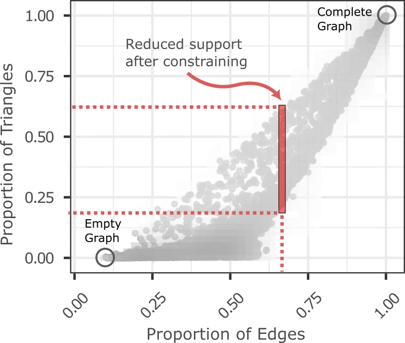{width="95%"}
:::

::: {.column width="50%" .incremental}
- Each dot is a possible network: its share of ties (x) and of triangles (y).
- For many parameter values, the model puts nearly all its probability on the **empty** or the **complete** network [@schweinberger_instability_2011].
- A small change in $\params$ flips it from one corner to the other.
- The simulation step then returns networks that look nothing like the data, and the fit **fails or never converges**.

::: {.takeaway .fragment}
The trouble runs along one direction: **the number of ties**. What if we take that direction away?
:::
:::
:::


# Part 2 -- Conditioning on the edge count {background-color="#00707a"}

## Take the edge count away {.compact data-menu-title="Conditioning, in a picture"}

Following @jonassonRandomTriangleModel1999, the distribution of edges in the edge + triangle model exhibits the following behavior:

```{=html}

```

::: {.takeaway .fragment fragment-index="3"}
The model no longer decides **how many** ties there are, only **where** they go.
:::


## What could it cost? {data-menu-title="The two questions"}


The full model is the conditional model **times** the model for the edge count:

$$
\Pr{\GRAPH}{\Graph = \graph; \params} =
\underbrace{\frac{\exp{\t{\params}\s{\graph}}}{\normconst{\params \mid \sn{k} = c}}}_{\text{Conditional}}
\times
\underbrace{\frac{\normconst{\params \mid \sn{k} = c}}{\normconst{\params}}}_{\text{Marginal: how many ties}}
$$

Fitting only the first factor throws the second away. Maximizing one is **not** the same as maximizing the product.

::: {.columns}
::: {.column width="50%" .fragment}
### Question 1

Does the edge count tell us anything about $\params_{-k}$?

*How much **information** do we lose?*
:::

::: {.column width="50%" .fragment}
### Question 2

When we actually fit both models, which one **converges**, how **fast**, and how **accurate** is it?
:::
:::


## One design for both questions {.compact data-menu-title="Study design"}


We simulate networks from the **full** ERGM (so the unconditional model is the correct one), with known coefficients.

::: {.columns}
::: {.column width="52%"}
| Model | Terms besides edges |
|:--|:--|
| Directed | homophily + mutual + **gwesp** |
| Directed | homophily + mutual + **gwdsp** |
| Directed | homophily + mutual + **gwesp $\times$ size** |
| Undirected | homophily + **gwesp** |
| Undirected | homophily + **gwesp + gwnsp** |
| Undirected | homophily + **gwdegree + gwesp** |
| Undirected | homophily + **gwesp, decay estimated** |
:::

::: {.column width="48%" .incremental}
- **Samples of $M$ networks**, $M \in \{1, 5, 10, 20\}$, as in multi-site or multi-classroom studies.
- **Sizes** from 10 to 100 nodes.
- **Densities** from 0.05 to 0.5.
- **Coefficients** drawn anew for every sample, from $\pm U(1, 2)$: positive and negative effects, all of them strong.
- **500 replicates** per model and $M$.
- Edges coefficient decreasing with $\text{log}\,n$ [@krivitsky_adjusting_2011].
:::
:::

::: {style="font-size: 85%; color: #666;"}
`gwesp`: shared partners of connected pairs (triangles). `gwdsp` / `gwnsp`: shared partners of all / unconnected pairs (two-paths). `gwdegree`: degree distribution. The undirected models follow brain-network applications.
:::


# Part 3 -- How much information do we lose? {background-color="#00707a"}

## Splitting the log-likelihood {.semi data-menu-title="Likelihood decomposition"}


Taking logs of the factorization, at the **true** parameter:

$$
\loglik{\params} \;=\;
\underbrace{\t{\params}\s{\graph} - \log{\normconst{\params \mid \sn{k} = c}}}_{l_{\text{cond}}:\ \text{which network, given its edge count}}
\;+\;
\underbrace{\log{\normconst{\params \mid \sn{k} = c}} - \log{\normconst{\params}}}_{l_{\text{marg}}:\ \text{the edge count}}
$$

::: {.incremental}
- No model is fit here. We only **simulate** at the true parameter, on the same networks as the main experiment ($M = 1$ and $5$).
- The marginal piece is about **$-4$ nats per network** at every density: the observed edge count has probability $\approx e^{-4} \approx 0.02$.
- $l_{\text{cond}}$ runs in the **hundreds to thousands** of nats: it grows with the number of pairs, the marginal piece with its logarithm.
:::

::: {.takeaway .fragment}
The edge count carries a fraction of a percent of the log-likelihood. But that is mostly size. The real question is what it says about the **coefficients**.
:::


## ERGMs are highly colinear {#ergms-colinear .compact data-menu-title="Information: the bend"}

How the expected value of another statistic changes with the edge count (schematic):

```{=html}

```

::: {.takeaway .fragment fragment-index="3"}
The full model can use the curve; the conditional model sees only the straight part. What it loses is the variance of the gap, $\Var{m(S_k) - B\,S_k}$ ([\<Fisher information\>](#fisher-information)).
:::


## Results: information loss {#info-loss .results background-color="#fdf6f2" .compact data-menu-title="Information: by design"}

<!-- Numbers: data/info_by_design.csv, built by scripts/info-by-design.R
     from the research repo's data/loglik/ and data/samples/. Figures in the
     appendix: #info-triangles and #info-by-term. -->

Information lost on each GW coefficient, at the true parameter (M = 1 and 5):

::: {style="font-size: 85%;"}
```{r}
#| output: asis
print(tab_info_design())
```
:::

::: {style="font-size: 75%; color: #666;"}
Median over samples where the coefficient is identified; 95% CI from order statistics. n.i.: share of samples where conditioning leaves it unidentified. Per sample: [\<gwesp by clustering sign\>](#info-triangles), [\<by term\>](#info-by-term).
:::

::: {.takeaway .fragment}
Typical losses are a few percent at most for every term but `gwnsp`. Negative coefficients are where conditioning costs: they are not identified in up to `r pct(max(idesign$not_id_neg))` of samples, and a negative `gwnsp` loses a median `r pct(idesign$med_neg[idesign$param == "gwnsp"])`.
:::


## How far to trust these numbers {.compact data-menu-title="Information: checks"}


::: {.columns .cols-gap}
::: {.column width="50%"}
### What holds up

::: {.incremental}
- **Exact check.** On networks of 4 to 7 nodes we can enumerate every graph. The estimator matches the exact value in all seven models (median absolute error 0.002--0.012).
- **Longer chains.** Eight times the simulation effort moves the results by at most 0.01, except for `gwdsp`, whose tail gets slightly worse (70% $\to$ 76%).
:::
:::

::: {.column width="50%"}
### What does not (yet)

::: {.incremental}
- **Not identified.** In up to a fifth of the samples a coefficient has no information at all under *either* model: the drawn coefficients freeze the network.
- **$l_{\text{cond}}$ itself** is not estimated reliably when the clustering coefficient is negative; the simulation path behaves like a phase transition. See the [\<details\>](#conditional-bridges).
- **Local.** Information at the truth is about precision in large samples. It says nothing about bias or about whether a fit converges.
:::
:::
:::

::: {.takeaway .fragment}
So far: for the most common specification, conditioning is nearly free on paper. Does that survive actual fitting?
:::


# Part 4 -- Does it work in practice? {background-color="#00707a"}

## Two ways to fit the same networks {.compact data-menu-title="Simulation: arms"}


::: {.columns}
::: {.column width="50%"}
### Unconditional

```{=html}

```

Estimates edges and its size effect: the **correctly specified** model, on its home turf.
:::

::: {.column width="50%"}
### Conditional

```{=html}

```

Drops edges; **each network** keeps its edge count (`condergm`, built on `ergm` and `ergm.multi`).
:::
:::

::: {.incremental}
- Both fit by **MCMC-MLE** with the `ergm` R package, from the **same starting values**, with a one-hour limit per fit.
- A fit **fails** if it times out, errors, or returns a non-finite estimate or standard error.
- Among the fits that converge: **bias** and **median absolute error** of the geometrically weighted coefficients, and **coverage** of the 95% confidence intervals.
- Seven models $\times$ four values of $M$ $\times$ 500 replicates, fit both ways on the University of Utah's cluster.
:::


## Results: the short version {.results background-color="#fdf6f2" .compact data-menu-title="Simulation: headline"}


**Positive clustering**: `r big(crow("positive")$samples)` samples, all models and M, each fit both ways ([\<all samples\>](#short-version-all)).

::: {.findings-grid .headline}

::: {.finding .fragment}
### <br>Converges more often

[**`r pct(crow("positive")$conv_cond)`** vs `r pct(crow("positive")$conv_uncond)`]{.badge .badge-strong}

In six of the seven models; tied with `gwnsp`
:::

::: {.finding .fragment}
### <br>Faster

[**`r num(crow("positive")$time_ok_cond, 0)` s** vs `r num(crow("positive")$time_ok_uncond, 0)` s]{.badge .badge-strong}

Median time of a converged fit
:::

::: {.finding .fragment}
### <br>Just as accurate

[**`r num(crow("positive")$mae_cond)`** vs `r num(crow("positive")$mae_uncond)`]{.badge .badge-strong}

Median absolute error; bias `r num(crow("positive")$bias_cond)` and `r num(crow("positive")$bias_uncond)`
:::

::: {.finding .fragment}
### <br>Improved coverage[^coverage]

[^coverage]: On samples where both fits are usable, conditional standard errors are `r pct(qrow("positive")$se_ratio - 1, 1)` wider (the information lost) while errors are equal, so its intervals cover slightly more: `r pct(qrow("positive")$cov_cond)` vs `r pct(qrow("positive")$cov_uncond)`. Both fall short of 95%.

[**`r pct(crow("positive")$cov_cond)`** vs `r pct(crow("positive")$cov_uncond)`]{.badge .badge-strong}

Coverage of 95% intervals
:::

:::

::: {style="font-size: 80%; color: #666; text-align: right;"}
Conditional vs. unconditional. Time, accuracy and coverage among converged fits.
:::

::: {.takeaway .fragment}
The conditional model matches or beats the correctly specified one on every measure, in a comparison designed to favor the unconditional model.
:::


## Where both models struggle: density {.compact data-menu-title="Simulation: density"}


::: {.columns}
::: {.column width="60%"}
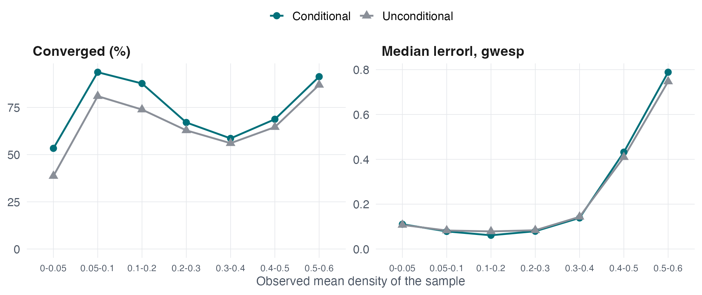{width="100%"}

::: {style="font-size: 80%; color: #666;"}
Directed model with homophily, mutual and gwesp; all $M$.
:::
:::

::: {.column width="40%" .incremental}
- Conditioning helps most in **sparse** networks, where observed networks usually are.
- Above a density of about 0.4, the error grows **in both models**.
- In a dense network every tie has many shared partners, so the weighted count is nearly a multiple of the edge count.
- With the edge count fixed, the standard deviation of `gwesp` in 55-node networks goes from 12 (density 0.2) to 1 (0.4) to 0.004 (0.6).
:::
:::

::: {.takeaway .fragment}
This is not a failure of conditioning: there is nothing left to estimate. See [\<densities above 0.5\>](#dense-networks).
:::


## Why fits fail {.compact data-menu-title="Simulation: failures"}


Share of fits by cause of failure, range over $M \in \{1, 5, 10, 20\}$:

```{r}
#| output: asis
print(tab_failures())
```

::: {.incremental}
- Conditioning nearly removes the failures in which **the chain does not mix**: the degeneracy story of part 1.
- It does nothing for **non-finite standard errors**. Those are mostly samples whose coefficients cannot be estimated by either model (the "not identified" samples of part 3).
- Timeouts grow with $M$ in both models, slightly more for the conditional one: hard models are slow either way.
- Still, `r pct(1 - cmp_all$conv_cond)` of conditional fits fail. Strong coefficients in small networks are a hard test by design.
:::


## Beyond convergence: the sign of clustering {.results background-color="#fdf6f2" .compact data-menu-title="Simulation: by clustering sign"}

<!-- Numbers: report/report.qmd, "Beyond convergence" (Table 12), rebuilt
     into data/sim_quality.csv by scripts/tables.R. -->

Every GW coefficient (all models and M); failures count. Conditional **vs** unconditional:

```{r}
#| output: asis
print(tab_quality())
```

::: {style="font-size: 75%; color: #666;"}
Clustering sign: that of `gwesp` (`gwdsp` in the model without `gwesp`).
:::

::: {.incremental}
- The design draws clustering **negative half the time**. In applied social networks it is almost always positive (McMillan, Felmlee and Ashford, 2022).
- With negative clustering both models fail most of the time: those samples add noise to the comparison, not signal.
- When both models give usable coefficients, the conditional standard errors are only `r pct(qrow("all")$se_ratio - 1, 1)` larger (median ratio), in line with the small information losses of part 3.
:::

::: {.takeaway .fragment}
In the case that matters in practice, the gap widens: `r round(100 * (qrow("positive")$acc_cond - qrow("positive")$acc_uncond))` more points of accurate coefficients with conditioning.
:::


## When the full model fails {.results background-color="#fdf6f2" .compact data-menu-title="Simulation: rescue"}

<!-- [1:30] The paired question: of the samples where the unconditional fit
     fails, how many does the conditional fit recover? And the reverse, as a
     control. Figure: fig/sim-paired-positive.png (scripts/figures.R, from
     data/sim_paired_density_sign.csv); rates by sign in data/sim_paired.csv. -->

**Positive clustering**, paired on the sample: `r big(psign("positive")$samples)` samples ([\<all samples\>](#rescue-all)).

::: {.columns}
::: {.column width="58%"}
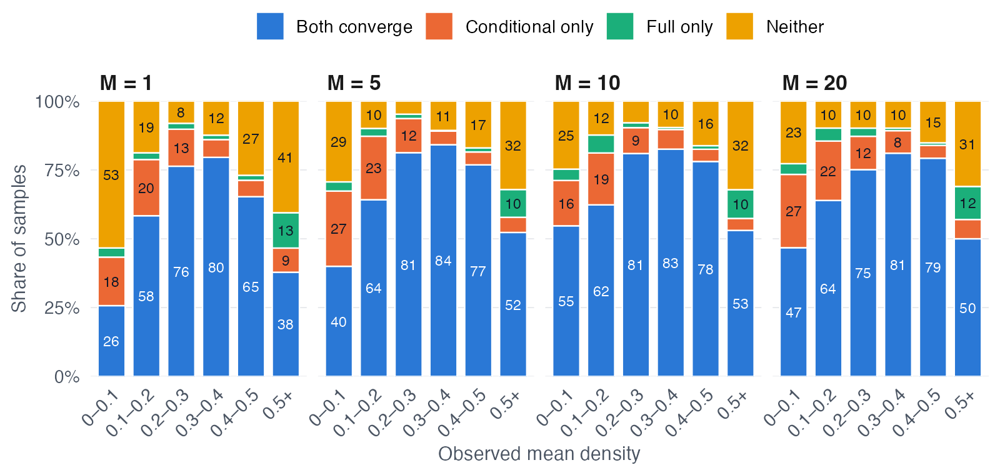{width="100%"}

::: {style="font-size: 80%; color: #666;"}
**Conditional only** (red) outnumbers **full only** (green) at every density below 0.5: `r pct(psign("positive")$only_cond / psign("positive")$samples)` against `r pct(psign("positive")$only_uncond / psign("positive")$samples)` of samples (exact McNemar, $p < 0.001$). Densities above 0.5 are rare in this design.
:::
:::

::: {.column width="42%"}
How often a model works when the other did not, conditional **vs** full:

```{r}
#| output: asis
print(tab_rescue())
```

::: {style="font-size: 80%; color: #666;"}
Usable: every GW coefficient with SE ≤ 1 and |estimate| ≤ 10.
:::
:::
:::

::: {.takeaway .fragment}
With positive clustering, the conditional model rescues **`r pct(prow("finite", "positive")$cond_given_uncond_failed)`** of the full model's failures; the reverse, `r pct(prow("finite", "positive")$uncond_given_cond_failed)`. With negative clustering neither rescues the other.
:::


## Converged is not the same as usable {.compact data-menu-title="Simulation: usable fits"}

<!-- [1:30] A rescue only counts if the rescued fit is accurate. Figure and
     numbers: report/cond-failures.md of the research repository (Figure 4,
     Table 4, positive clustering rows); copied by `make figs-from-repo`. -->

::: {.columns}
::: {.column width="58%"}
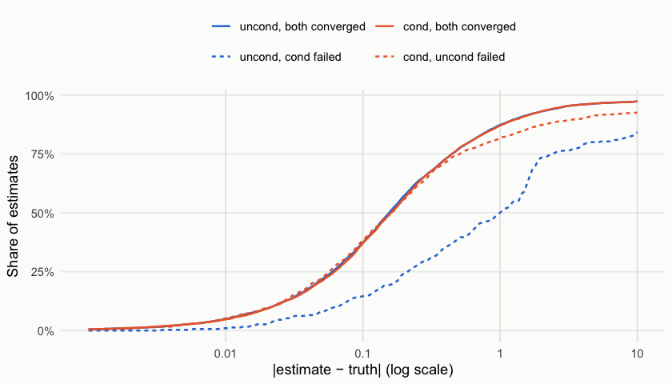{width="100%"}

::: {style="font-size: 80%; color: #666;"}
Positive clustering. Absolute error of the GW coefficients of converged fits; the counts on the right are estimates (one per GW coefficient), not samples. Solid: both models converged. Dashed: only this model converged.
:::
:::

::: {.column width="42%" .incremental}
- When both converge, the two models are **indistinguishable**: median absolute error 0.16, 95% intervals cover 92--93%.
- **Full model, after the conditional failed** (305 estimates): median error **1.00**, coverage **53%**. Keeping only the usable ones does not help (0.41, 45%).
- **Conditional, after the full model failed** (976 estimates): median error **0.16**, coverage **91%**: a normal fit.
:::
:::

::: {.takeaway .fragment}
The full model's rare rescues are confidently wrong, even when their standard errors look fine. The conditional model's rescues are as good as any other fit.
:::


# Closing {background-color="#00707a"}

## Conditional ERGMs: a promising start {#conclusion .compact .conclusion data-menu-title="Summary"}

::: {.concl-lead}
::: {.concl-text}
**ERGMs** are graphical models for networks. Born in sociology, they fit **any** network: brains, genes, health care.
:::

::: {.concl-apps}
[](#neuroscience-whole-brain-connectivity)
[](#biology-gene-regulation)
[](#many-networks-at-once-pooled-ergms)
:::
:::

Fixing the edge count, in this first study:

::: {.columns .concl-cards}
::: {.column width="33%" .fragment}
[](#when-the-full-model-fails)

**Converges more, twice as fast**  
`r pct(crow("positive")$conv_cond)` vs `r pct(crow("positive")$conv_uncond)`; `r num(crow("positive")$time_ok_cond, 0)` s vs `r num(crow("positive")$time_ok_uncond, 0)` s
:::

::: {.column width="33%" .fragment}
[](#converged-is-not-the-same-as-usable)

**Just as accurate**  
Error `r num(crow("positive")$mae_cond)` vs `r num(crow("positive")$mae_uncond)`; its rescues are sound
:::

::: {.column width="33%" .fragment}
[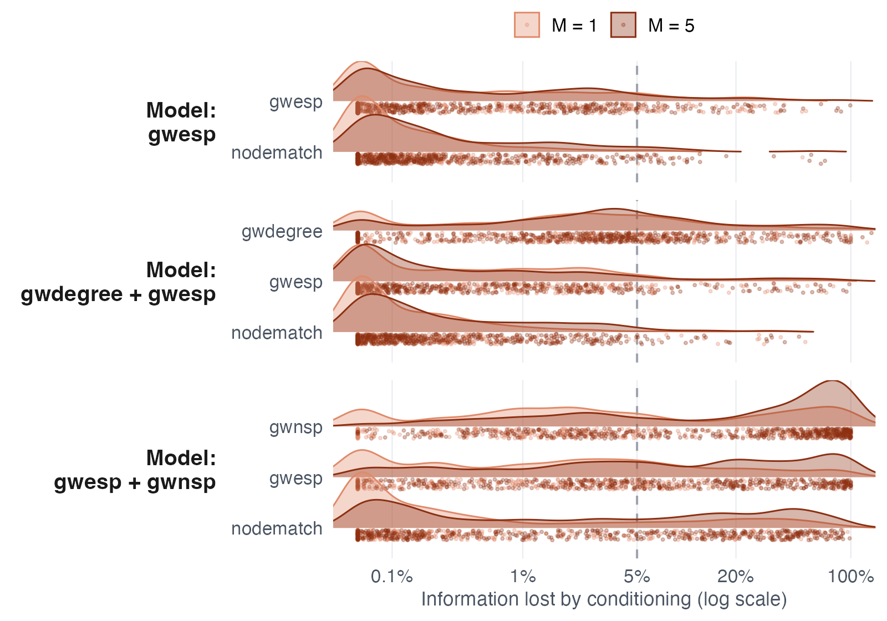](#info-loss)

**Loses little information**  
Except terms that bend with the edge count
:::
:::

::: {.takeaway .fragment}
Today's software is tuned for the full model, so this is a **lower bound**. Next: full inference in two steps ([\<seeding\>](#seeding-proof-of-concept)).
:::


## What comes next {.compact .where-next data-menu-title="Next steps"}


:::: {.columns}

::: {.column width="33%" .fragment}
###  Larger networks

Single networks with 500 and 1,000 nodes, where the unconditional model is at its slowest. The runs are in progress.

Why the information loss for `gwnsp` does not turn into worse estimates.
:::

::: {.column width="33%" .fragment}
###  Seeding

Use the conditional fit as the **starting point** of the full model:

1. Fit the conditional model.
2. Fit only edges, the rest held fixed.
3. Start the full fit from there.

See a [\<proof of concept\>](#seeding-proof-of-concept).
:::

::: {.column width="33%" .fragment}
###  Power and data

How many networks does a study need? Conditional models make the simulations behind a power analysis feasible ([\<example\>](#power-analysis)).

Applications: brain networks from fMRI, gene-interaction networks.
:::

::::


## Thank you! {.center data-menu-title="Thank you"}

::: {.columns}

::: {.column width="50%"}
::: {style="font-size: 1.3em;"}
Conditional Exponential-Family Random Graph Models
:::

::: {style="font-size: 0.9em; color: #666;"}
**George G. Vega Yon, Ph.D.**

Division of Epidemiology<br>University of Utah

 <https://ggvy.cl>
:::
:::

::: {.column width="50%"}
```{mermaid}

```
:::

:::


# Appendix {visibility="uncounted" background-color="#00707a"}

## Why model a network? {.compact data-menu-title="Why model networks"}


We want to do more than describe or draw a network; we want to **explain it**. 

::: {.columns}
::: {.column width="33%" .fragment}
###  Public health

Do people befriend those who share their behavior, or is it that friends of friends tend to meet?

Contact networks, vaccination behavior, health-care teams.
:::

::: {.column width="33%" .fragment}
###  Neuroscience

What connectivity patterns characterize a healthy brain? Do diseases alter them?

Whole-brain connectivity from fMRI [@simpson_exponential_2011].
:::

::: {.column width="33%" .fragment}
###  Biology

What patterns of interaction are typical of a protein network?

Protein--protein and gene-regulatory networks.
:::
:::

::: {.takeaway .fragment}
In a network, ties depend on each other. Regression assumes they do not. Exponential-family Random Graph Models (ERGMs) are built for the dependence.
:::

## The model in one equation {data-menu-title="ERGM equation"}


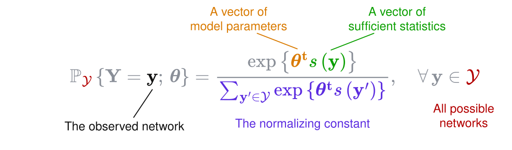{width="85%" fig-align="center"}

::: {.incremental}
- A network is **one draw** from a distribution over all possible networks, $\GRAPH$.
- Networks with more of the features we count are more (or less) likely, depending on the sign of $\params$.
- It is the same family as logistic regression, with the whole network as the outcome [@Hunter2008].
:::

## Reading the coefficients {.semi data-menu-title="Interpretation"}


Because the conditional is a logit, each coefficient is a **log-odds ratio**, holding the rest of the network fixed:

::: {.incremental}
- $\theta_{\text{homophily}} = 1$: a tie between two alike nodes has $e^{1} \approx 2.7$ times the odds of a tie between two unlike ones.
- $\theta_{\text{mutual}} = 2$: a tie that reciprocates an existing one has $e^{2} \approx 7.4$ times the odds.
- $\theta_{\text{edges}} = -3$: the baseline. A tie that creates nothing else has probability $\approx 0.05$.
:::

::: {.takeaway .fragment}
A logistic regression in which each tie's predictors are the other ties.
:::


## Fitting is the hard part {.semi data-menu-title="Estimation"}

::: {.columns}
::: {.column width="55%"}
The normalizing constant adds over **every possible network**:

$$
\normconst{\params} = \sum_{\graph' \in \GRAPH} \exp{\t{\params}\s{\graph'}}
$$

::: {.incremental}
- A directed network with $n$ nodes has $2^{n(n-1)}$ possible configurations. With $n = 10$, that is $2^{90} \approx 10^{27}$.
- So the likelihood is **approximated by simulation** (Markov chain Monte Carlo maximum likelihood, MCMC-MLE).
:::
:::

::: {.column width="45%" .fragment}
```{=html}

```
:::
:::

::: {.takeaway .fragment}
This only works if the simulated networks look something like the observed one. Often they do not.
:::

## Fix what you do not want to model {.compact data-menu-title="Conditional ERGM"}


- The edges coefficient, $\theta_k$, **cancels** (one fewer parameter to estimate).
- The empty and the complete network are no longer possible outcomes.
<!-- - It is the idea behind **conditional logistic regression** (matched case--control studies), applied to networks [@snijders_conditional_2010; @pattison_conditional_2013]. -->
<!-- - Sometimes it is simply the truth: surveys that cap the number of friends you can name, or brain networks thresholded to a fixed density. -->

::: {.takeaway}
With several networks, each keeps its own edge count, so every network's density drops out at once.
:::

Let $\sk{\graph}{k}$ be the number of ties. Only consider networks with **exactly as many ties as the one we observed**, $\textcolor{#c0491f}{c}$:

::: {style="font-size: 85%"}
$$
\begin{aligned}
\Prcond{\GRAPH}{\Graph = \graph}{\sk{\Graph}{k} = \textcolor{#c0491f}{c};\ \params}
& \class{fragment}{= \frac{\exp{\t{\params}\s{\graph}}}{\normconst{\params \mid \sn{k} = \textcolor{#c0491f}{c}}}} %
\class{fragment}{= \frac{\exp{\theta_{k}\textcolor{#c0491f}{c}}\;\exp{\t{\params_{-k}}\sk{\graph}{-k}}}{\exp{\theta_{k}\textcolor{#c0491f}{c}}\;\sum_{\graph' \in \GRAPH:\, \sk{\graph'}{k} = c}\exp{\t{\params_{-k}}\sk{\graph'}{-k}}}} \\
& \class{fragment}{= \frac{\exp{\t{\params_{-k}}\sk{\graph}{-k}}}{\normconst{\params_{-k} \mid \sn{k} = \textcolor{#c0491f}{c}}}}
\end{aligned}
$$
:::

::: {style="font-size: 85%; color: #666;"}
$\normconst{\params \mid \sn{k} = c} = \sum_{\graph' \in \GRAPH:\, \sk{\graph'}{k} = c} \exp{\t{\params}\s{\graph'}}$ is the normalizing constant over the networks with $c$ ties; $-k$ means "all terms but the $k$-th".
:::

## The right yardstick: Fisher information {#fisher-information .compact visibility="uncounted" data-menu-title="Information identity"}


How precisely can each model pin down $\params_{-k}$? Write $S_k = \sk{\Graph}{k}$ for the edge count and $S_{-k} = \sk{\Graph}{-k}$ for the other statistics.

::: {.columns}
::: {.column width="50%" .fragment}
### Full model

It must also estimate $\theta_{k}$, which costs precision. What is left is the **efficient information**:

$$
I_{\text{eff}} = \Var{S_{-k}} - \frac{\Cov{S_{-k}}{S_k}\,\Cov{S_k}{S_{-k}}}{\Var{S_k}}
$$
:::

::: {.column width="50%" .fragment}
### Conditional model

The variability of the statistics **within** an edge count, averaged over edge counts:

$$
I_{\text{cond}} = \Expected{\VarCond{S_{-k}}{S_k}}
$$
:::
:::

::: {.fragment}
The difference is exact, with $m(S_k) = \ExpectedCond{S_{-k}}{S_k}$ and $B$ the slope of $S_{-k}$ on $S_k$:

$$
I_{\text{eff}} - I_{\text{cond}} = \Var{m(S_k) - B\,S_k}
$$
:::

::: {.takeaway .fragment}
Conditioning loses information only where the expected statistics **bend** with the edge count. A strong but linear relation costs nothing. See the [\<algebra\>](#information-algebra).
:::

::: {.absolute bottom="0" right="0" style="font-size: 80%; color: #666;"}
Go [\<back\>](#ergms-colinear)
:::


## The information identity {#information-algebra .compact visibility="uncounted" data-menu-title="Information: algebra"}

::: {.callout-caution}
This slide has not been verified by a human reader.
:::

One network, edges coefficient $\theta_k$ unknown. $S_k = \sk{\Graph}{k}$: edge count; $S_{-k} = \sk{\Graph}{-k}$: the other statistics; $m(S_k) = \ExpectedCond{S_{-k}}{S_k}$; $B = \Cov{S_{-k}}{S_k} / \Var{S_k}$.

1. The law of total covariance gives $\Var{S_{-k}} = \Expected{\VarCond{S_{-k}}{S_k}} + \Var{m(S_k)} = I_{\text{cond}} + \Var{m(S_k)}$.

2. Since $\Cov{m(S_k)}{S_k} = \Cov{S_{-k}}{S_k}$,

$$
\Var{m(S_k) - B S_k} = \Var{m(S_k)} - B\,\Var{S_k}\,\t{B}.
$$

3. Subtracting,

$$
I_{\text{eff}} - I_{\text{cond}} = \Var{S_{-k}} - B\,\Var{S_k}\,\t{B} - I_{\text{cond}} = \Var{m(S_k) - B S_k} \succeq 0.
$$

::: {.incremental}
- No orthogonality between edges and the other parameters is needed: the cancellation is exact.
- If $S_{-k}$ itself is a linear function of $S_k$, both sides are zero: equal information does not mean the coefficient can be estimated.
- With several networks and a shared size effect, the full sample's information is assembled first and the nuisance block removed once.
:::

::: {.absolute bottom="0" right="0" style="font-size: 80%; color: #666;"}
Go [\<back\>](#fisher-information)
:::


## Results: triangles lose almost nothing {#info-triangles .results background-color="#fdf6f2" .compact visibility="uncounted" data-menu-title="Information: mutual + gwesp"}


::: {.columns}
::: {.column width="64%"}
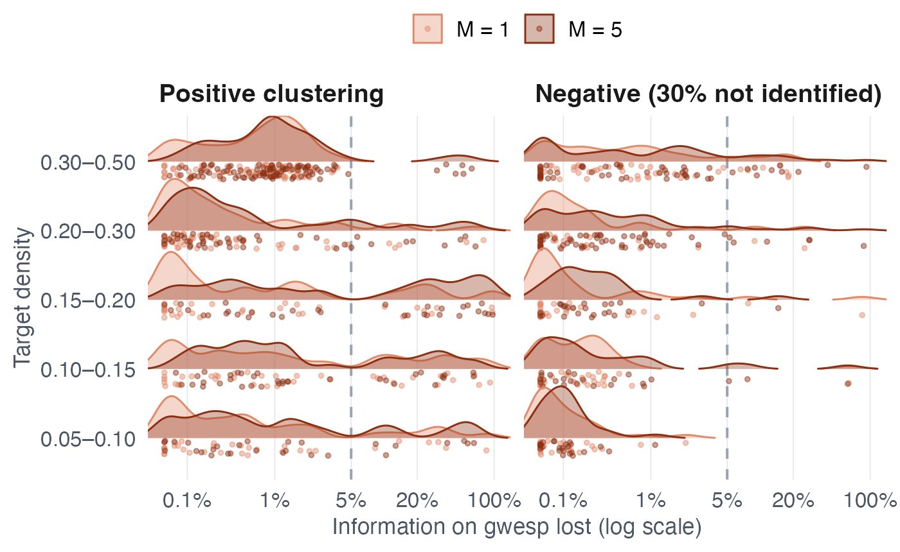{width="100%"}

::: {style="font-size: 80%; color: #666;"}
Directed model with homophily, mutual and gwesp. One point per sample where `gwesp` is identified; curves are densities.
:::
:::

::: {.column width="36%" .incremental}
- **Median loss under `r pct(ceiling(100 * max(ibins$med)) / 100)`** in every cell. Homophily and reciprocity: nothing to see.
- **Positive clustering, sparse networks**: a second hump at 20--100%. `r pct(irow(1, "positive")$over_5)` of samples lose more than 5%, `r pct(irow(5, "positive")$over_5)` with five networks.
- **Negative clustering**: the loss is small or total. The conditional model cannot identify `gwesp` in `r pct(inonid("negative"))` of samples.
:::
:::

::: {.takeaway .fragment}
The typical sample loses almost nothing. When conditioning costs, it costs on `gwesp`: in sparse, clustered networks, and by erasing it when clustering is negative.
:::

::: {.absolute bottom="0" right="0" style="font-size: 80%; color: #666;"}
Go [\<back\>](#info-loss)
:::


## Results: but it depends on the term {#info-by-term .results background-color="#fdf6f2" .compact visibility="uncounted" data-menu-title="Information: by term"}


::: {.columns}
::: {.column width="66%"}
{width="100%"}

::: {style="font-size: 80%; color: #666;"}
Three undirected models (all with homophily); each row is one of the model's coefficients. One point per sample where it is identified.
:::
:::

::: {.column width="34%"}
::: {.fragment}
### Loses little

Homophily and `gwesp`: median below `r pct(max(iloss("undirected_gwesp", c("gwesp", "nodematch.x"), 5)), 1)`.
:::

::: {.fragment}
### Loses more

`gwdegree`: median `r pct(iloss("undirected_gwdegree_gwesp", "gwdegree", 5), 1)` with five networks. `gwnsp`: **`r pct(iloss("undirected_gwesp_gwnsp", "gwnsp", 5))`**, and it drags `gwesp` with it. `gwdsp` and size effects (not shown) also lose more.
:::

::: {.fragment}
### Why

Two-paths and degrees grow with the **square** of the edge count: that is the bend.
:::
:::
:::

::: {.absolute bottom="0" right="0" style="font-size: 80%; color: #666;"}
Go [\<back\>](#info-loss)
:::


## Estimating the conditional log-likelihood {#conditional-bridges .compact visibility="uncounted" data-menu-title="Conditional bridges"}

$l_{\text{cond}}$ needs $\normconst{\params \mid \sn{k} = c}$, a sum over all networks with $c$ edges. We bridge from the uniform distribution ($\params_{-k} = 0$, where the sum is known) to the true parameter, forward and in reverse. If a chain only lags, the two directions bracket the value and the gap closes with effort.

```{r}
#| output: asis
print(tab_bridges())
```

::: {style="font-size: 85%; color: #666;"}
Median gap between the forward and reverse bridges, in nats.
:::

- With fewer triangles than chance at a fixed edge count, the forward path does not cross: 362 of 2,999 networks had an impossible $l_{\text{cond}} > 0$, all with a negative `gwesp` coefficient.
- The information results do not use these bridges.

::: {.absolute bottom="0" right="0" style="font-size: 80%; color: #666;"}
Go [\<back\>](#how-far-to-trust-these-numbers)
:::


## Densities above 0.5 {#dense-networks .compact visibility="uncounted" data-menu-title="Dense networks"}

From an earlier design with target densities up to 0.9; all models and $M$ pooled.

```{r}
#| output: asis
print(tab_dense())
```

- The weighted terms cannot be estimated by either model. The conditional model says so (wide intervals, 95% coverage); the unconditional one is confidently wrong.
- Homophily and reciprocity stay accurate at any density, whenever a fit converges.

::: {.absolute bottom="0" right="0" style="font-size: 80%; color: #666;"}
Go [\<back\>](#where-both-models-struggle-density)
:::


## Other estimation choices {.compact visibility="uncounted" data-menu-title="SA and starting values"}

::: {.columns .cols-gap}
::: {.column width="50%"}
### Stochastic approximation

Fit in an earlier design and dropped:

- It converged 15--25 points more often than MCMC-MLE.
- Its errors on the weighted coefficients were 25--45% larger.
- Its standard errors were too small: coverage of 76--88%.
- Conditioning made it **slower**, and it failed more often than the unconditional version.
:::

::: {.column width="50%"}
### Starting values

By default, `ergm` starts unconditional fits from the pseudo-likelihood estimate and conditional ones from contrastive divergence.

- Here, both models start from the same point.
- Sharing the start helped the conditional model with `gwdsp` and `gwesp + gwnsp`, and hurt it with `gwdegree`.
:::
:::


## Seeding: proof of concept {#seeding-proof-of-concept .compact visibility="uncounted" data-menu-title="Seeding"}

One network with 100 nodes, from a model with edges, triangles and homophily ($\params = \{-6.0, 1.25, 2.5\}$). Stochastic approximation, started two ways.

::: {.columns}
::: {.column width="45%"}
| | Default start | Conditional start |
|:--|--:|--:|
| Edges | $-3.15$ | $-3.29$ |
| Triangles | $-0.05$ | $0.04$ |
| Homophily | $1.06$ | $2.00$ |
| Log-likelihood | $-6{,}054$ | $-4{,}102$ |

The default MCMC-MLE did not return a fit.
:::

::: {.column width="55%"}
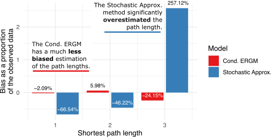{width="100%"}
:::
:::

::: {.absolute bottom="0" right="0" style="font-size: 80%; color: #666;"}
Go [\<back\>](#what-comes-next)
:::


## Power analysis {#power-analysis visibility="uncounted" data-menu-title="Power"}

> How many networks do you need to detect a homophily effect? --<br> [@vegayonPowerMulticollinearitySmall2023a in JASA]

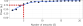{width=65% .nostretch}

::: {.absolute bottom="0" right="0" style="font-size: 80%; color: #666;"}
Go [\<back\>](#what-comes-next)
:::


## The short version: all samples {#short-version-all .results background-color="#fdf6f2" .compact visibility="uncounted" data-menu-title="Simulation: headline, all samples"}


**Both clustering signs**: `r big(cmp_all$samples)` samples ([\<positive only\>](#results-the-short-version)). Broken down [\<by M\>](#results-by-m) and [\<by model\>](#results-by-model).

::: {style="font-size: 75%; color: #666;"}
11 of the 14,000 samples lost a fit to a file error on a cluster node and are left out.
:::


::: {.findings-grid .headline}

::: {.finding .fragment}
### <br>Converges more often

[**`r pct(cmp_all$conv_cond)`** vs `r pct(cmp_all$conv_uncond)`]{.badge .badge-strong}

In six of the seven models; tied with `gwnsp`
:::

::: {.finding .fragment}
### <br>Faster

[**`r num(cmp_all$time_ok_cond, 0)` s** vs `r num(cmp_all$time_ok_uncond, 0)` s]{.badge .badge-strong}

Median time of a converged fit, faster in every model
:::

::: {.finding .fragment}
### <br>Just as accurate

[**`r num(cmp_all$mae_cond)`** vs `r num(cmp_all$mae_uncond)`]{.badge .badge-strong}

Median absolute error; bias `r num(cmp_all$bias_cond)` and `r num(cmp_all$bias_uncond)`
:::

::: {.finding .fragment}
### <br>Honest intervals

[**`r pct(cmp_all$cov_cond)`** vs `r pct(cmp_all$cov_uncond)`]{.badge .badge-strong}

Coverage of 95% intervals
:::

:::

::: {.takeaway .fragment}
The conditional model matches or beats the correctly specified one on every measure, in a comparison designed to favor the unconditional model.
:::

::: {.absolute bottom="0" right="0" style="font-size: 80%; color: #666;"}
Conditional vs. unconditional. Time, accuracy and coverage among converged fits.
:::


## Results: more networks, same story {#results-by-m .results background-color="#fdf6f2" .compact visibility="uncounted" data-menu-title="Simulation: by M"}

All samples, both clustering signs ([\<back\>](#short-version-all)).


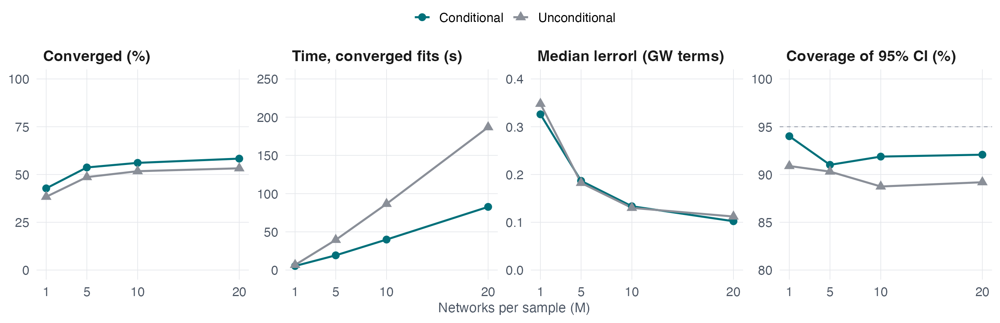{width="100%"}

::: {.incremental}
- **Consistency.** The error falls from `r num(cg("M1")$mae_cond)` with one network to `r num(cg("M20")$mae_cond)` with twenty, at the same rate in both models.
- **Time.** The gap widens with $M$: a converged fit of twenty networks takes `r num(cg("M20")$time_ok_cond / 60, 1)` minutes against `r num(cg("M20")$time_ok_uncond / 60, 1)`.
- **Coverage.** The unconditional intervals get slightly too narrow as $M$ grows; the conditional ones hold at `r pct(cg("M20")$cov_cond)`.
:::


## Results: model by model {#results-by-model .results background-color="#fdf6f2" .compact visibility="uncounted" data-menu-title="Simulation: by model"}

All samples, both clustering signs ([\<back\>](#short-version-all)).


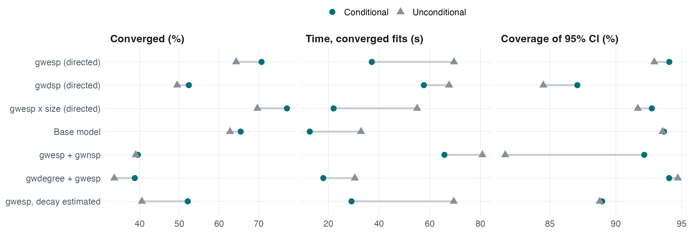{width="80%" fig-align="center"}

::: {.incremental}
- The gain in convergence is largest with an estimated decay (+`r gain("undirected_gwesp_curved")` points). With `gwesp + gwnsp` there is none: `r pct(cg("undirected_gwesp_gwnsp")$conv_cond)` against `r pct(cg("undirected_gwesp_gwnsp")$conv_uncond)`.
- With two-path and degree terms the conditional fits **time out more often**: `r pct(timeout_share("undirected_gwesp_gwnsp", "cond"))` against `r pct(timeout_share("undirected_gwesp_gwnsp", "uncond"))` with `gwnsp`, `r pct(timeout_share("undirected_gwdegree_gwesp", "cond"))` against `r pct(timeout_share("undirected_gwdegree_gwesp", "uncond"))` with `gwdegree`.
- Recall part 3: these terms **lose the most information**. That costs precision, not convergence: with positive clustering, the conditional model alone is usable on 20% of the samples losing 5% or more, against 4% under 1%.
:::

## When the full model fails: all samples {#rescue-all .results background-color="#fdf6f2" .compact visibility="uncounted" data-menu-title="Simulation: rescue, all samples"}

<!-- [1:30] The paired question: of the samples where the unconditional fit
     fails, how many does the conditional fit recover? And the reverse, as a
     control. Figure and numbers: report/cond-failures.md of the research
     repository (Figure 1, Table 1); rates by sign rebuilt into
     data/sim_paired.csv by scripts/tables.R. -->

**Both clustering signs**, paired on the sample: `r big(paired_all$samples)` samples ([\<positive only\>](#when-the-full-model-fails)).

::: {.columns}
::: {.column width="58%"}
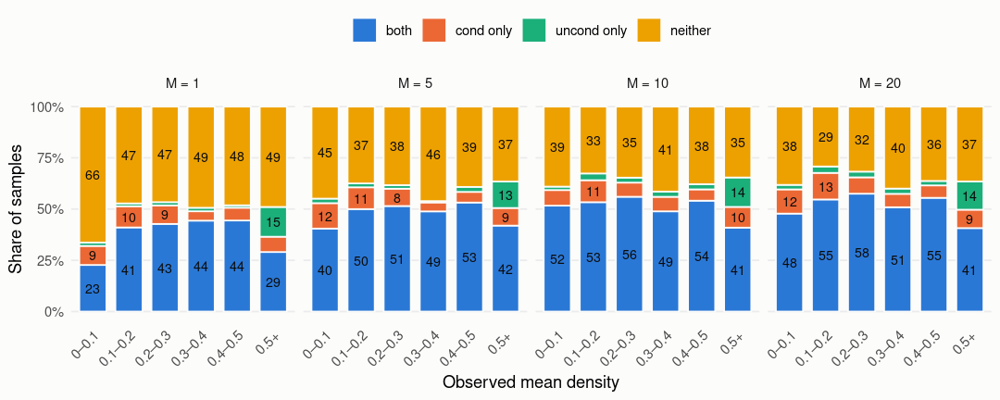{width="100%"}

::: {style="font-size: 80%; color: #666;"}
**Conditional only** (red) outnumbers **full only** (green) at every density below 0.5: `r pct(paired_all$only_cond / paired_all$samples)` against `r pct(paired_all$only_uncond / paired_all$samples)` of samples (exact McNemar, $p < 0.001$). 11 of the 14,000 samples lost a fit to a file error on a cluster node.
:::
:::

::: {.column width="42%"}
How often a model works when the other did not, conditional **vs** full:

```{r}
#| output: asis
print(tab_rescue())
```

::: {style="font-size: 80%; color: #666;"}
Usable: every GW coefficient with SE ≤ 1 and |estimate| ≤ 10.
:::
:::
:::

::: {.takeaway .fragment}
With positive clustering, the conditional model rescues **`r pct(prow("finite", "positive")$cond_given_uncond_failed)`** of the full model's failures; the reverse, `r pct(prow("finite", "positive")$uncond_given_cond_failed)`. With negative clustering neither rescues the other.
:::


## References {visibility="uncounted" .smaller}

::: {#refs}
:::
